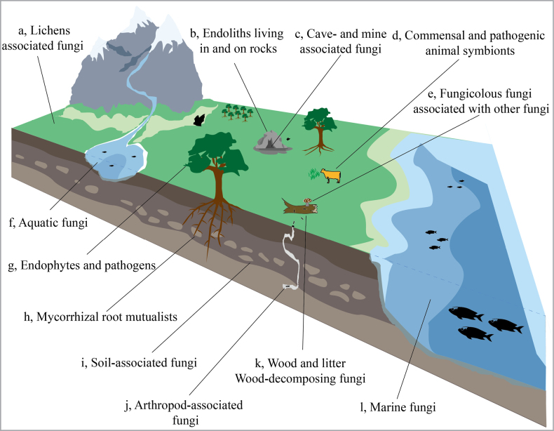
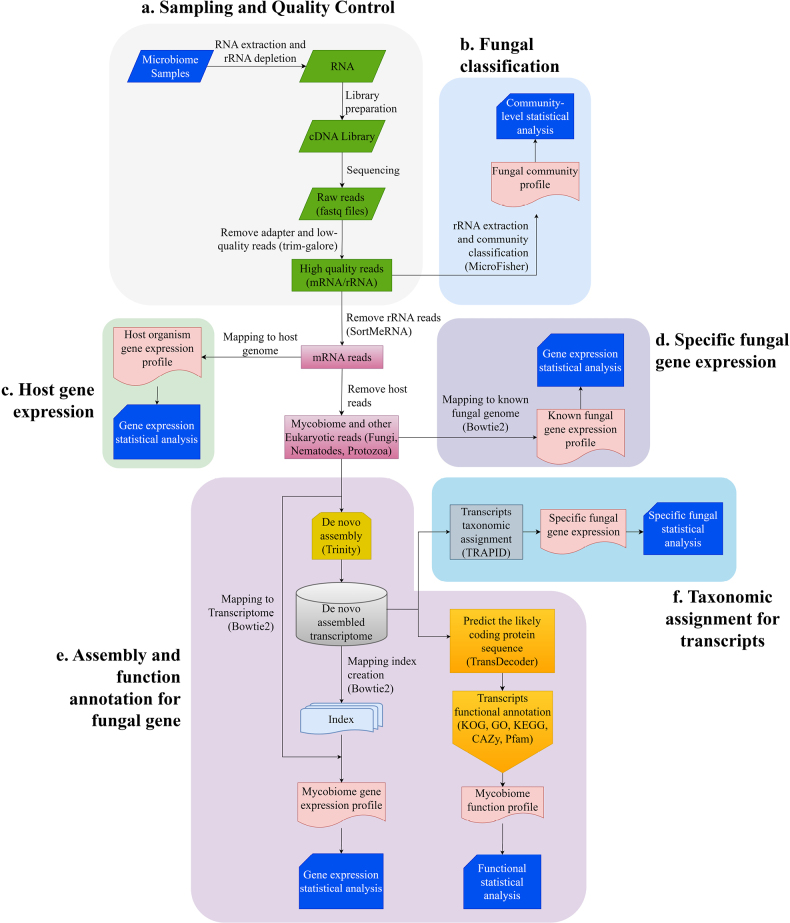
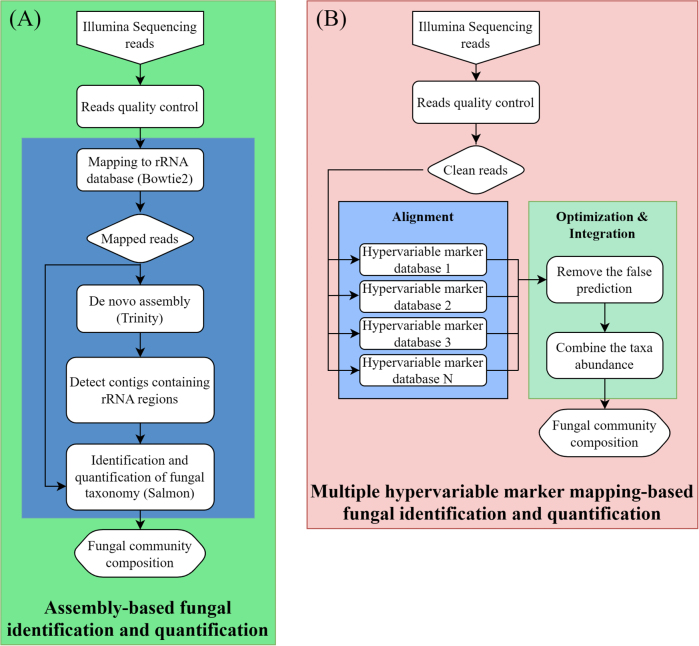
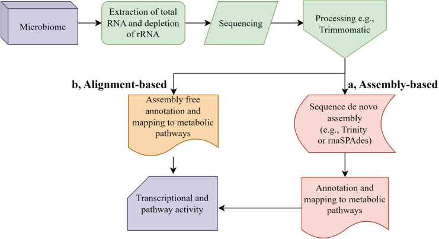

# IMA Fungus：真菌宏转录组如何同时回答“谁在活跃、正在做什么”？一篇综述梳理两大分析路线与核心难题

土壤里检测到了大量真菌DNA，是否意味着这些真菌正在分解植物残体？某个担子菌在ITS扩增子数据中丰度很高，能否进一步说明它在现场表达了木质纤维素降解酶？森林土壤样品中检出一个糖苷水解酶转录本，怎样判断它究竟来自真菌还是细菌？

这些问题都指向环境微生物组研究中越来越重要的一层信息：**群落中哪些生物正在表达哪些基因，以及这些表达活动可能对应怎样的生态过程。**

2026年4月29日，*IMA Fungus* 发表综述《Interpreting fungal ecological contributions through taxonomic and functional profiling of metatranscriptomics》。作者Wenxing Hu、Jingfei Hu、Zhen Wang和Haihua Wang系统整理了真菌宏转录组的分析思路，重点比较两类计算策略：**先组装再注释（assembly-based）**，以及**将reads直接比对参考数据库（alignment-based）**。

这是一篇**方法学综述**。文中引用不同研究中的软件性能和应用案例，并讨论方案选择；它没有提出全新的真菌宏转录组软件，也没有在一套统一的数据集上重新测试所有列出的工具。读懂这一点，才能准确理解文章给出的经验建议。

## 1｜从“有哪些真菌”走向“哪些真菌在表达功能”

环境真菌研究长期依赖ITS或核糖体RNA相关扩增子。它们成本相对低、参考数据库积累丰富，适合调查群落组成，却难以直接获得功能基因的表达证据。

宏基因组能够检测群落中的基因和潜在代谢能力，但基因存在不代表采样时正在表达。宏转录组通过环境RNA捕获转录活动，可以把群落分类与表达状态联系起来。例如，在林地土壤中，可以同时关注外生菌根真菌的氮转运相关转录本与腐生真菌的植物细胞壁降解酶转录本；在海洋水体中，可以追踪真菌来源的碳水化合物活性酶（CAZymes）表达。

这类分析的核心问题包括三层：**转录本来自哪个生物类群？它编码什么功能？在不同环境或处理之间表达如何变化？**

需要明确，RNA丰度是某个时间窗口内的分子状态指标。检测到酶基因转录，不等于直接测得相应酶活或生态过程速率；还可能存在翻译、酶分泌、底物可及性和环境条件等限制。

*图1展示从陆地、海洋到动物肠道等环境中的真菌生态位。它是一张背景示意图，用于说明研究对象的广泛性。*

## 2｜样本处理决定了后面能回答哪些问题

作者概括的分析路径从环境采样和RNA提取开始，随后进行文库构建、测序质控、宿主背景过滤、物种分类、功能注释及整合解释。

实际操作中，**rRNA去除和poly(A)富集的选择非常关键**。

对于希望估计真菌mRNA表达的研究，去除大量rRNA能够改善有效测序深度，poly(A)富集也有利于捕获部分真核mRNA。但如果研究还希望利用ITS、LSU等核糖体标记进行真菌分类，那么过度去除rRNA可能同时消除重要的分类信号。相反，在以细菌和真菌共同贡献为目标的研究中，仅依赖poly(A)富集又可能压低原核生物转录本的代表性。

因此，应在建库前确定主要目标：更重视真菌mRNA的功能表达、同时识别细菌与真菌活动，还是希望使用rRNA标记提高真菌分类分辨率。对复杂样本而言，单独的总RNA/rRNA标记信息与mRNA富集数据互为补充，是可以考虑的设计方案。

另外，土壤中的腐殖酸、植物样品中的宿主RNA、微生物间极不均衡的RNA比例，都可能影响有效测序量。综述引用的研究指出，复杂环境样本中的真菌RNA常常只占很小一部分，有些土壤场景甚至不足5%。**一亿条总reads并不等于一亿条可用于真菌功能分析的reads**。

*图2归纳从样本到物种层面功能推断的主要模块。实际应用应把建库方式、测序深度和参考数据库的限制纳入设计。*

## 3｜技术路线一：组装后再进行分类与功能注释

组装型路线首先将短RNA reads连接为更长的contigs或转录本，再为这些序列赋予分类及功能信息。

### 较长序列带来更多信息

一个150 bp的read可能只覆盖某个酶家族的保守片段。多个reads组装成较长转录本后，可以保留更多特征位点、蛋白结构域及部分转录本结构，使物种分类和功能注释更有依据。

综述列举的转录组组装工具包括Trinity、rnaSPAdes、Oases、Trans-ABySS、SOAPdenovo-Trans及BinPacker。常用的后续步骤包括：用TransDecoder识别可能的编码区；通过DIAMOND、eggNOG-mapper、Pfam与InterPro进行序列或结构域注释；借助TRAPID或最低共同祖先（LCA）算法整合分类信息；最后将原始reads重新映射到组装转录本上进行定量。

这种路线适合深入研究真菌代谢途径、功能基因家族及环境响应，也更有机会发现参考数据库尚未包含的序列。

### 组装也会改变能够看到的群落

低丰度真菌的reads可能不足以形成连续转录本；表达量非常不均衡的基因可能出现碎片化；不同物种共享的保守片段还可能造成错误连接。真菌普遍具有内含子、可变剪接、多拷贝基因家族和复杂转录本，增加了这些困难。

因此，组装后能够注释的转录本集合往往偏向表达量高、测序覆盖充分的生物群或功能。**未组装出来不能直接解释为该物种或基因没有表达。**

同时，MEGAHIT等宏基因组组装器虽然也可能被用于混合数据，但它们并非专门为真核可变剪接转录本设计；若研究目标是完整转录本及异构体，应优先评估转录组专用组装器。

## 4｜技术路线二：reads直接比对，适合快速筛查

直接比对型路线跳过从头组装步骤，将质控reads匹配到现有基因组、核糖体标记或蛋白数据库。它的主要优势是计算速度快、资源需求相对低，特别适合大规模样本的初步分类和比较。

综述讨论了几类工具：Kraken2和Centrifuge依靠参考基因组实现高效分类；EukDetect利用经过整理的真核标记寻找微生物真核生物；FunOMIC侧重真菌相关的蛋白序列识别；MicroFisher使用真菌特异或富于变异的核糖体标记进行分类。

这些工具回答的问题并不完全相同，参考数据库也不同。**MetaPhlAn4的通用预置标记库主要服务于细菌等原核群落；不能直接默认它适合作为复杂环境真菌的完整分类工具。**

2025年一项模拟真菌群落的比较研究被综述引用：不同工具的检测覆盖、假阳性及相对丰度估计存在差异。EukDetect和FunOMIC在某些场景表现出优势，但这个结果不能直接推广成“任何真菌宏转录组都应使用某一软件”的排名。该类模拟比较与来自真实环境RNA的数据具有不同验证边界。

*图3将较长转录本分类与多标记read比对并列，突出两条路线在序列长度、数据库依赖和计算成本上的区别。*

## 5｜功能注释：最大的挑战往往是确认转录本的生物来源

宏转录组的功能结果通常进一步注释到KEGG、eggNOG、Pfam、InterPro、GO及CAZy等数据库。对真菌生态学来说，CAZymes、转运蛋白、氧化还原酶、次生代谢相关酶和共生相关基因都很重要。

问题在于，细菌和真菌共享大量保守代谢基因。例如，一个很短的糖苷水解酶read可能只支持它属于某个GH家族，却不足以高置信度判断来源物种。把所有GH相关reads归入真菌，就可能高估真菌在木质纤维素降解中的表达贡献。

这也是**功能注释与分类注释必须结合**的原因。可行做法是先确认编码蛋白的分类归属，再统计真菌来源的功能读段或转录本；对分类不明确的序列保留“未分配”，并对结果开展不同比对阈值或数据库条件下的敏感性分析。

需要特别重视，普通功能数据库对一些真菌特有或高度分化的基因家族覆盖有限。比如次生代谢基因簇、特定CAZymes、外生菌根相关功能和分泌蛋白，可能在通用注释体系中被遗漏或错误归属。

antiSMASH和SMURF能够帮助识别部分次生代谢基因簇，但其核心优势依赖基因组邻域信息。**单纯从宏转录组短reads中发现PKS、NRPS相关片段，并不能可靠恢复完整BGC的边界、基因顺序或调控关系。**

*图4强调，两种功能分析策略在能否恢复长转录本、识别蛋白结构域以及连接分类与功能方面具有不同优势。*

## 6｜为什么真菌宏转录组比细菌的更难？

综述总结了三个反复出现的技术瓶颈。

**第一，真菌转录本复杂。** 内含子、可变剪接、大型或重复基因家族会增加组装与注释难度。锈菌等部分真菌拥有显著较大的基因组，结构复杂性更突出。长读长转录组（如PacBio Iso-Seq）能帮助改善已有参考基因组的基因结构与异构体注释，但其成本和在低丰度复杂环境样本中的应用限制仍需评估。

**第二，参考基因组代表性不均衡。** 公共真菌基因组主要集中在子囊菌和担子菌，许多早分化类群、环境罕见类群及未培养真菌缺少近缘参考。数据库缺口会造成reads无法分类、只能分类到较高阶元或被错误匹配到较远亲缘类群。

**第三，标准化不足。** rRNA处理方式、测序深度、比对阈值、转录本定量和功能丰度分母的选择，都会影响跨样本及跨研究的可比性。不同文库类型之间，所谓“每百万reads”不一定对应相同的可检测RNA总体。

对数据解释来说，有必要分别报告总reads、质控后reads、宿主/核糖体去除比例、真菌归属reads、可注释功能reads，以及最终每个结果采用的丰度分母。

## 7｜给实际项目设计的一套可执行思路

如果准备利用土壤、根际、菌床或其他复杂生态样本开展真菌宏转录组研究，可按以下逻辑组合两类路线。

**先明确目标与建库方法。** 若核心目标是研究哪些真菌正在表达某类降解酶，可以重点加强mRNA捕获与功能注释；若目标是尽可能完整地描述活跃真菌群落，应保留可用于分类的标记信息，并评估rRNA去除对分类的影响。

**先做快速筛查，再决定组装深度。** 利用适合真菌的标记或序列数据库，对样本的真菌组成和有效reads比例进行初步检查。若只有极少数真菌reads，直接投入极大规模组装可能难以得到高质量转录本。

**对关键样本做从头组装。** 采用Trinity或rnaSPAdes等转录组组装器，检查转录本长度分布、冗余、完整性及疑似嵌合情况；随后进行ORF预测、多数据库功能注释和分类归属。对于短片段和同源家族，应降低物种水平解释的置信度。

**使用统一参考进行跨样本定量。** 如果研究差异表达，应尽可能用一致的参考转录本或基因集合进行定量，并考虑测序深度、文库组成差异及生物学重复。对跨物种表达贡献的比较，需要同时考虑同源基因长度、参考覆盖和多重比对的影响。

**把表达发现与生态证据衔接。** 对CAZymes而言，可以结合酶活、底物降解、培养实验或稳定同位素示踪等独立信息。对共生或病原性相关转录本，应结合宿主状态、空间分布和实验验证。表达活跃只能支撑一定范围内的功能推断。

这是一套基于综述的**实务建议**，不是论文作者已经发布并系统验证的标准化官方流程。

## 8｜AI和长读长会改变什么？

作者把未来方向放在长读长测序、真菌特异数据库和机器学习。全长转录本能够改善剪接结构及同源拷贝识别；扩大的真菌基因组数据库可以减少大量环境reads只能归入“未知”的状况；机器学习则可能帮助远缘蛋白家族的识别与未知功能注释。

不过，这些方向对应的是不同层级的问题。蛋白结构预测能够提供功能线索，却不能替代实验酶活；深度学习分类器依赖训练集覆盖，面对未充分测序的早分化真菌同样可能发生分布偏移。对于生态过程的定量预测，更需要将转录信号与环境变量及过程测量连接。

## 9｜这篇综述最重要的启示

真菌宏转录组的价值，在于把环境中的生物身份与转录活动联系起来。

组装型方法保留更多序列上下文，适合深入追踪酶家族、复杂转录本和新功能；直接比对型方法计算效率高，适合大规模样本的初步筛查。两者可以在同一个项目中互补应用。无论选择哪条路线，参考数据库覆盖度、真菌RNA捕获效率和物种—功能归属的可靠性都将直接决定结论质量。

当研究目标从“存在什么基因”进一步走向“环境中哪些真菌正在表达什么功能”时，宏转录组提供了重要增量。真正稳健的生态解释还需要跨过测序技术、分类数据库、功能注释和实验验证之间的几道关口。

---

**论文信息**

Hu W, Hu J, Wang Z, Wang H. (2026). Interpreting fungal ecological contributions through taxonomic and functional profiling of metatranscriptomics. *IMA Fungus* 17: e185187. Published 29 April 2026.

DOI: https://doi.org/10.3897/imafungus.17.185187

PMC原文：https://pmc.ncbi.nlm.nih.gov/articles/PMC13150532/

原论文为CC BY 4.0开放获取。图1–图4为原始主文图，使用时保留作者及期刊来源；个别图内第三方素材以原始credit line为准。