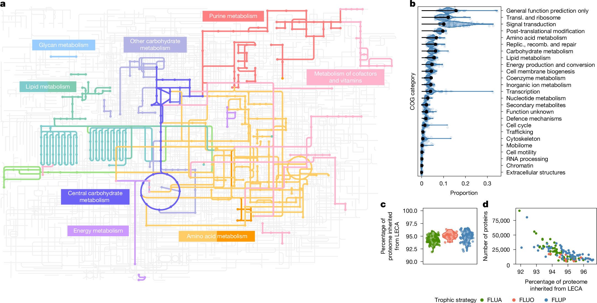
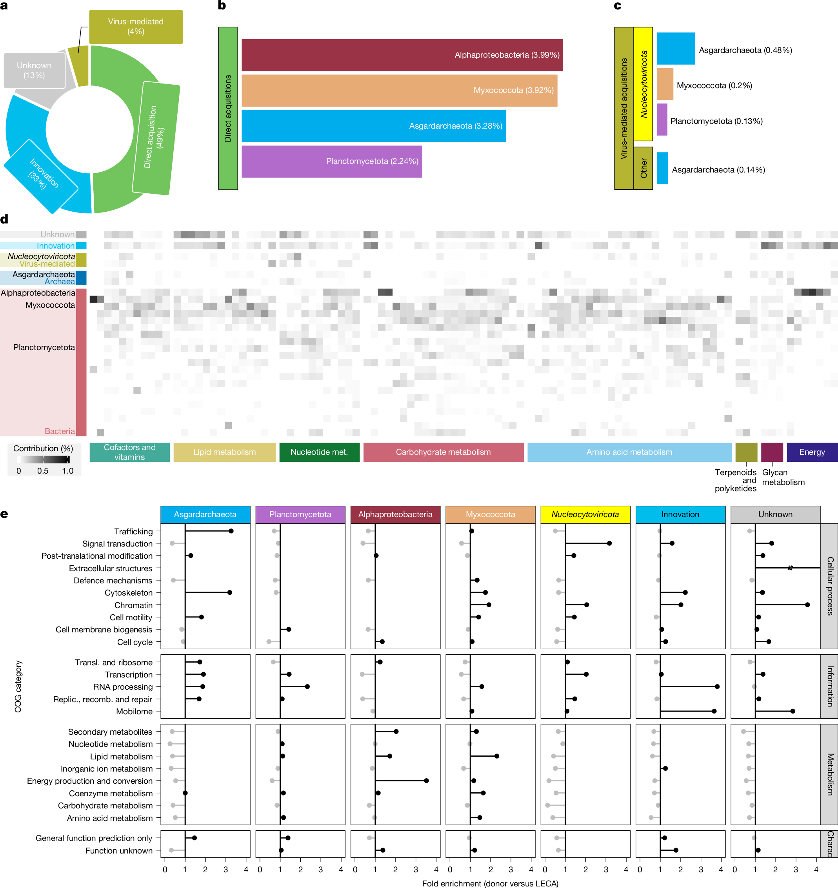
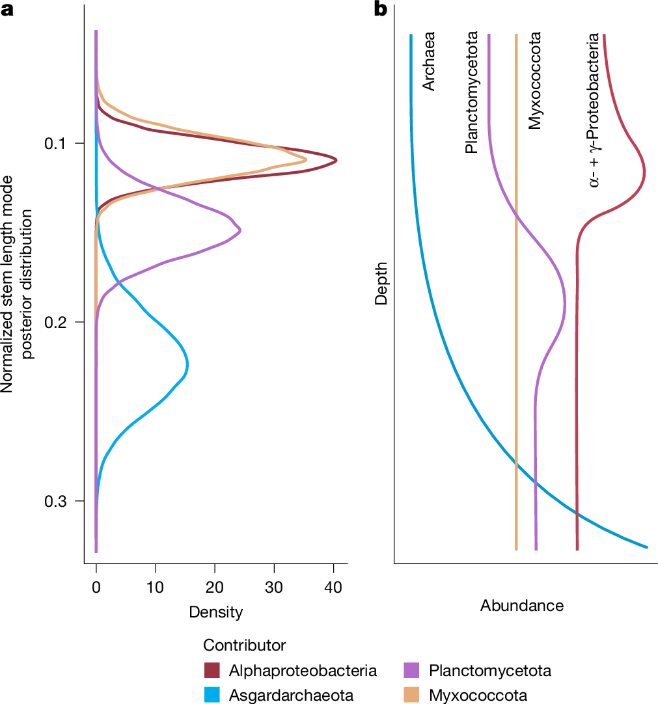
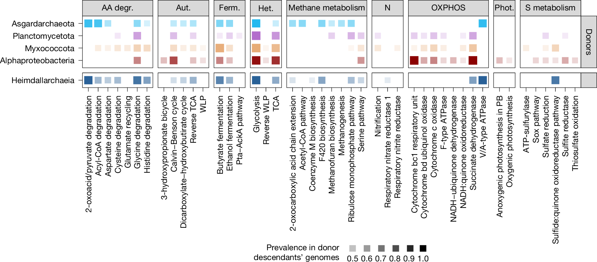

# Nature：真核生物起源可能远比“两位祖先的一次共生”复杂——重建LECA基因祖源，发现多轮细菌基因流入与病毒介导的转移

**从约6.6万个原核基因组、超过130万个病毒蛋白簇与三套真核蛋白质组出发，一项大规模系统发育基因组学研究重新审视了真核细胞的形成。**

为什么真核生物会突然拥有细胞核、复杂膜系统、线粒体和大量负责信息处理与能量代谢的蛋白质？它的祖先到底经历了哪些微生物之间的接触与基因交换？

现代真核生物的起源（eukaryogenesis）通常围绕两个核心参与者展开：一方是与 **Asgard古菌** 有亲缘关系的宿主祖先，另一方是与 **α-变形菌（Alphaproteobacteria）** 有关、最终演化为线粒体的细菌祖先。线粒体内共生在真核细胞演化中占据核心位置，但几十年来，一个更难回答的问题始终存在：**最后共同真核祖先中的大量细菌来源基因，究竟是不是都来自线粒体祖先？**

2026年6月10日，巴塞罗那超级计算中心和生物医学研究所的Moisès Bernabeu、Saioa Manzano-Morales、Marina Marcet-Houben以及Toni Gabaldón在 *Nature* 发表论文《Gene ancestries reveal diverse microbial associations during eukaryogenesis》。

研究团队汇集覆盖真核生物、细菌、古菌与病毒的蛋白序列，重建 **最后真核共同祖先（last eukaryotic common ancestor，LECA）** 可能拥有的蛋白家族，再逐一寻找这些家族最接近的非真核分支。结果显示，除了传统两大祖源，**黏细菌门（Myxococcota）与浮霉菌门（Planctomycetota）** 也留下了持续可见的基因祖源信号；部分基因还表现出与 **核质大DNA病毒门（Nucleocytoviricota）** 有关的潜在转移轨迹。

作者进一步利用系统树枝长比较不同祖源的相对时期，并结合可能的代谢功能，提出真核生物的形成可能经历了 **多轮、部分重叠的微生物关联和水平基因转移（HGT）**。这个结果拓展了经典的古菌—细菌共生框架，但不能把每个推断出的供体都直接等同于一个曾经存在的内共生体。

## 一、经典模型能够解释线粒体，却留下大量细菌基因的来源之谜

线粒体源自细菌内共生是现代演化生物学的重要共识。线粒体保留部分细菌特征，许多与其相关的基因又转移到了宿主核基因组中，这提供了一条强有力的演化证据链。

另一方面，系统发育研究表明，真核生物的信息处理系统——例如与DNA复制、转录和翻译相关的部分机器——具有明显的古菌亲缘关系。

这形成了广为人知的“嵌合”图景：真核细胞汇集了古菌来源的信息处理模块与大量细菌来源的代谢模块。

但经典“两方参与”的模型仍需要面对一个事实：过去的LECA祖先蛋白质组分析早已发现，**细菌祖源信号远不止能够可靠指向α-变形菌的那一小部分**。可能的解释包括：其他细菌曾经提供基因；原来的古菌或线粒体祖先在更早期已经获取了外源基因；或者系统树受到不完整采样、快速进化、错误定根与污染的影响。

新论文的研究问题因此十分明确：如果把真核、原核与病毒参考数据库扩大，并系统控制这些混杂因素，能否找出 **独立于Asgard古菌和线粒体祖先的其他稳定供体信号**？

## 二、不是直接画一棵物种树，而是为LECA的每个基因家族追溯祖源

LECA不是地球上最早的真核细胞，而是 **现存所有真核生物最后共享的共同祖先**。它之前可能已经经历了漫长的演化和多轮基因交换，因此重建LECA提供的是一份累积完成后的遗传“账本”。

作者首先整理了276个真核生物蛋白质组，剔除质量不佳和潜在问题样本后保留256个。为了减少不同真核分支测序数量不均衡带来的偏差，研究者再建立三套各包含100个蛋白质组、但物种组成部分不同的数据集（eTOLDB A、B、C）。三套数据在蛋白层面的重合率约46%，用于检查祖源推断是否过度依赖某一组物种。

在原核和病毒方面，研究使用GTDB的62,291个细菌和3,412个古菌物种代表基因组，在属与目层级通过泛基因组策略进行压缩，减少冗余和原核生物内部近期HGT造成的干扰。同时加入来自RVDB的 **1,319,927个病毒蛋白序列簇代表**，使病毒能够与细菌、古菌一同进入候选祖源搜索。

整个方法不是“用BLAST找到一个最高分物种就认为它是供体”。作者先通过OrthoFinder构建直系同源群（OG），保留在真核演化树两大主干和多个超类群中广泛分布的家族；随后用HMM profile搜索非真核同源序列，再建立最大似然蛋白系统树，分析LECA分支最近的姐妹类群。

为了降低某些早期家族多次复制和丢失的影响，作者还根据基因树拓扑重新拆分并精炼LECA正交群（mLECA-OG），同时进行污染过滤、重采样和不同筛选严格程度的比较。

在较宽松的至少三个真核超类群标准下，LECA祖先重建平均得到 **12,907个mLECA-OG**；提高到至少五个超类群时，平均得到 **7,751个mLECA-OG**。他们进一步得到包含 **5,317个KEGG Orthology（KO）功能编号** 的保守注释共识集。

这些数字代表不同层面的统计：mLECA-OG是推断的祖先蛋白家族，KO是功能同源编号。**5,317个KO不能简单理解为LECA只有5,317个基因。**

*图1：a展示按KEGG重建的祖先代谢模块；b比较LECA与现生自由生活单细胞吞噬营养真核生物的COG功能；c比较LECA与不同营养方式现生真核生物共有的KO；d展示LECA遗传遗产占现生基因组的比例。*

重建结果支持一个已经相当复杂的LECA：它具有核酸与蛋白质处理系统、细胞内物质运输机器、内吞、吞噬体、溶酶体与过氧化物酶体，以及能够进行有氧呼吸的线粒体。其代谢特征更符合异养和可能的好氧生活方式。相比之下，细胞周期调节机制的重建仍较有限。

作者也明确指出，这种自动化祖先重建更适合描述 **可能已经存在的家族和功能类别**，不应当拿来直接绘制LECA的精确细胞形态。

## 三、关键结果：两类意料之外的细菌祖源与线粒体信号一样值得关注

作者利用LECA蛋白家族系统树中的最近非真核姐妹分支作为祖源代理，首先把家族分成三大类。

约 **33%** 的家族在严格筛选后只保留真核同源蛋白，被归为“推定真核创新”（putative innovations）。这里的“创新”是一种操作性归类：它也可能包括原核同源序列已经高度分化、发生结构域重排，或现有数据库未能检出的情况。

约 **53%** 具有可识别的非真核相关序列，因而显示“获得”（acquisition）信号；余下约 **13%** 由于亲缘关系和转移方向不够明确，被列为“来源未知”。这些比例来自不同数据集的平均结果，因此是近似值。

作者还整理了 **918个KO** 作为较严格筛选下的真核特征功能集合。这个集合有助于界定可追溯的真核创新，但不能直接视为真核生命起源时一次性产生的918个新基因。

最引人注目的是直接获得类家族的供体归属。除了：

- **α-变形菌：约3.99%** 的重建LECA蛋白质组；
- **Asgard古菌：约3.28%**；

还出现了两个在多套参考数据和筛选条件下相对稳定的细菌信号：

- **黏细菌门（Myxococcota）：约3.92%**；
- **浮霉菌门（Planctomycetota）：约2.24%**。

这些数字描述的是 **符合筛选条件的系统发育祖源归属占比**，不代表各类微生物“贡献了百分之几的现代真核基因组”，也不是所有原核来源基因的完整分解。

*图2：a统计祖源类型；b显示直接获得类家族的主要祖源；c显示潜在病毒介导转移所追溯的更早供体；d展示不同祖源对代谢模块的贡献；e比较功能类别富集情况。*

这张图最有意思的地方，不只是新的供体名字，还在于它们所对应的功能并没有完全按照“一个供体负责一种功能”来分配。很多代谢模块同时混合来自不同祖源的成分，符合LECA蛋白质组的高度嵌合性质。

## 四、怎样排除一个疑问：会不会只是α-变形菌参考数据库缺失？

如此深远的进化事件很容易受系统树误差影响。举例来说，如果一个真正来自α-变形菌的基因，在数据库中恰好缺少最近的α-变形菌亲属，算法可能错误地把它归给其他细菌类群。

作者专门设计了一个 **模拟“缺失供体”的阴性对照**：从参考数据库中移除α-变形菌，再对α-变形菌的蛋白家族进行相同祖源分析。

结果确实出现了符合预期的误归属：大量基因优先指向与α-变形菌较近的γ-变形菌等类群，随后随着亲缘距离变远而依次减少。

LECA中黏细菌门和浮霉菌门的祖源分布没有表现出这种简单的“最近类群替代”模式。加之不同数据集、不同严格程度下结果相对稳定，以及这些家族系统树的可解析程度没有明显差于α-变形菌信号，作者认为 **单纯的系统发育噪声或线粒体祖先采样不足，难以解释全部观察结果**。

这并不意味着所有单个家族的供体已经被完全确定。研究识别的是门级或较高阶元的整体祖源信号，具体早期供体、基因移动方向和原始宿主关系仍有很大不确定性。

## 五、这些基因是同时进入真核祖先，还是分批到来的？

识别供体后，作者进一步追问转移时间。

他们使用一种基于基因树 **标准化枝长比（normalized stem length）** 的相对时间推断。简化理解，先看LECA分支与最近非真核姐妹祖先之间的枝长，再用LECA内部从祖先到现生末端的典型枝长进行标准化，以便比较不同家族的演化距离。

在这个模型中，较长的标准化干枝意味着相对更古老的关系，多个家族的枝长分布若集中在相似范围，可能代表某一时期相对密集的基因获得，即“转移浪潮（transfer wave）”。

研究通过贝叶斯框架比较不同供体的分布峰值，结果显示：

**Asgard古菌祖源信号最为古老；在细菌来源中，浮霉菌门的信号通常早于线粒体祖先和黏细菌门，后两者的转移时间分布存在相当程度的重叠。**

*图3：a以贝叶斯后验分布表示不同祖源可能的相对时间；b展示这些现代细菌和古菌类群在微生物席垫（microbial mats）中的层位关联。图b是生态情景类比，并非对数十亿年前生态系统的直接采样。*

这项分析是论文叙事的重要支撑，但其证据边界同样重要。

首先，**枝长不是绝对地质时间**。不同家族的进化速率、序列替换饱和与基因丢失都可能影响标准化距离。其次，群体层面的“波峰”不代表所有基因都在同一个事件、同一天或同一种细胞相互作用中被引入。最后，研究没有直接测得这些古老事件发生于多少亿年前。

因此，“浮霉菌门可能参与线粒体获得之前的阶段”是具有统计支持的历史推断，而不是直接观察到一次前线粒体共生事件。

## 六、为什么作者把这些古老关联放进“微生物席垫”？

微生物席垫是由多种微生物形成的分层生态系统，不同深度拥有不同氧、硫、氢和有机碳条件。现代微生物席垫中，古菌和多种细菌可以共同生活，并形成代谢交换或依赖。

论文发现，主要推断供体的现代成员都常见于这类富集微生物的环境；某些席垫中的层位分布也与他们推断的祖源获得顺序存在相似性。

因此作者提出一个连贯的生态学情景：原始真核谱系可能生存在微生物高度密集的群落里，不断与各种细菌发生接触、营养交换、基因转移，最终积累形成真核细胞的复杂基因库。

这个解释比简单的“两种原核生物相遇一次”提供了更丰富的生态背景。不过，**现代席垫结构不能直接证明真核祖先生活在完全相同的环境中**。席垫是与数据相容、具有合理性的情景模型，而非论文的新化石证据。

作者将其与“线粒体形成之前可能存在多次共生或关联”的假说相联系，但始终没有从系统树推断出一个明确的古老细胞形态。

## 七、代谢功能能够告诉我们这些潜在供体在做什么吗？

为了更具体地讨论早期微生物之间可能交换了哪些资源，研究者筛选了现生后裔中与LECA相应祖源拥有较多共同KO的基因组，重建各类代谢途径的出现比例。

*图4：不同祖源相关现生基因组中，具有至少50%通路完整度的代谢模块所占比例。方块的颜色深浅表示相应代谢特征的普遍程度。最下方加入Heimdallarchaeota作为比较。*

论文讨论了几条有意思的结果。

在选择的 **Asgard类群现生基因组** 里，没有发现完整的甲基辅酶M还原酶（MCR）及相关甲烷代谢所需组成，因而作者认为早期Asgard参与者未必一定是产甲烷古菌。相反，一些发酵途径具有较高出现比例，例如乙醇发酵约0.63、丁酸发酵约0.67。这些是现生类群中推断的通路普遍程度，不是古老祖先的直接酶活值。

对于 **浮霉菌门和黏细菌门**，硫酸盐还原等代谢潜力可能与氢、硫和有机物之间的互作模型有关。论文报告的硫酸盐还原相关通路出现比例约为0.50和0.44，并提到一些浮霉菌门后裔存在较弱的厌氧氨氧化（anammox）潜力信号。

对于 **线粒体细菌祖先**，代谢重建支持有氧呼吸能力；相比之下，氢化酶相关证据不足以强力支持某些早期“氢假说”所需要的代谢模式。部分光合系统具有中等出现比例，但这不能据此宣布线粒体祖先已经被证明是一种光合细菌。

作者对这组分析的定位很谨慎：用现代后裔中经常共同出现的功能，来间接推断未知供体可能具有什么代谢特征。这不是严格意义上针对某个确定物种树的祖先状态重建，也没有充分的数据确定古老互作一定是互利共生、寄生、外共生还是内共生。

## 八、最出人意料的角色：大型DNA病毒可能参与了古老的基因转移

这篇论文的新意还包括将病毒纳入LECA基因祖源研究。

当某个LECA基因家族的系统树中，最近的非真核姐妹分支来自病毒，研究者会继续寻找病毒分支之外的更早姐妹类群。若系统树支持“原核—病毒—真核”的嵌套关系，就可能意味着病毒曾作为基因传递的中介。

约 **4.5%的mLECA-OG系统树** 呈现病毒姐妹群信号。其中特别显著的是 **Nucleocytoviricota（核质大DNA病毒门）**，约占病毒姐妹群信号的 **74%**，相当于重建LECA蛋白质组的约 **3.32%**。在作者采用严格的时间和方向筛选后，论文讨论了病毒介导HGT至少占所检出获得事件的一部分这一结论。

这些潜在病毒介导获得的基因，在信号转导、蛋白激酶、染色质和翻译后修饰相关功能中表现出相对富集。病毒很可能改变早期真核谱系与外界微生物交换遗传物质的方式。

但这一推断 **不等于已经发现某个感染LECA的古老病毒化石，也不意味着每一个病毒姐妹群都证明发生过病毒到真核的HGT**。进化时间太久、基因可能在真核生物与病毒之间反复流动，而现生参考病毒远非完整。作者还提出，某些病毒相关基因可能先来自已经灭绝的其他原始真核样谱系，再通过病毒进入通往LECA的祖先分支。

特别需要留意分母：**“4.5%的系统树显示病毒姐妹群”与“4.5%的全部获得事件由病毒介导”虽然在论文不同段落分别被报告，但不是可以直接互换的同一个数学定义。** 图2a和后续严格过滤结果应分别阅读。

## 九、这篇论文对水平基因转移研究最值得借鉴的是什么？

这项研究的方法学启发远超真核生物起源。

**第一，不要把最近BLAST命中当作确定供体。** 作者使用同源群、HMM搜索、复杂替换模型和大规模系统树，再结合最近姐妹分支与多个过滤条件推断祖源。对跨界HGT，单一相似性指标难以充分区分远缘同源、基因丢失和真实转移。

**第二，比较多套组成不同的数据库。** 作者把真核蛋白质组分成三套部分重叠参考集，检验主要结果是否受采样分布影响。对于某个供体类群明显被过度测序或未充分采样的情况，这类稳定性检验极其重要。

**第三，要主动模拟错误来源。** 移除α-变形菌的阴性对照，直接回答“如果真实供体缺失，算法会把它归到谁？”这种应力测试在深度进化事件研究中比单纯提高bootstrap阈值更具解释力。

**第四，区分供体祖源与转移机制。** 一个基因显示黏细菌门亲缘信号，意味着有可追溯的遗传联系；它不自动告诉我们，是直接HGT、通过另一细菌或病毒间接转移，还是通过尚未知晓的古老谱系传递。论文在病毒部分正是通过进一步检查嵌套姐妹群来提出“间接介导”的可能性。

**第五，明确时间推断是什么层级。** 基于标准化枝长的转移浪潮提供相对顺序，而非具有化石校准的绝对日期。把“更早的祖源关联”写成“早于线粒体形成的某次确定内共生事件”，会超出数据支持的范围。

对于研究真菌HGT、外源功能基因簇或大型DNA病毒与宿主基因交换的项目，这五个层面的交叉检验都很值得借鉴。不过，LECA这样极古老的祖先事件与现代真菌谱系间HGT有不同时间尺度；论文的统计时间模型和筛选阈值不能不经验证就直接套用。

## 十、还有哪些核心科学问题没有解决？

这篇论文最强的贡献是证明 **多种祖源信号在严格过滤后仍然存在**，并提供可比较的相对时间与代谢情景。它同时留下了几个边界。

**祖源归属不等于实际供体物种。** 现生浮霉菌门或黏细菌门与远古供体之间已经相隔漫长时间。研究反映的是可识别的亲缘关系，难以还原具体古老物种。

**基因转移不能直接确定细胞间关系。** 内共生、菌体外长期接触、捕食、寄生和间接基因转移，都可能形成复杂祖源。论文作者没有找到浮霉菌或黏细菌曾进入原始真核细胞内部的直接证据。

**系统树历史与细胞演化历史并非一回事。** 如果线粒体祖先在进入宿主前已经从其他细菌获得某个基因，那么现在基因树中的最近亲缘可能指向那个其他细菌，而实际把它带入真核祖先的载体却是线粒体祖先。作者通过控制分析弱化了这种解释作为全部数据来源的可能性，但无法逐一排除。

**“微生物席垫”是与结果相容的生态模型。** 它富有启发性，但现生空间分层和古老基因获得的相对顺序之间不存在一一对应的直接证据。

**病毒的历史信号更需谨慎。** 深时系统树的定根、病毒与细胞之间基因流动方向、病毒样序列的污染和高分化问题，都可能改变解释。大型DNA病毒参与是重要新假说，不是已经完整再现的古老感染过程。

未来若能增加新的Asgard古菌、深分支真核生物与大型DNA病毒参考基因组，并发展更好地处理基因丢失、重复和转移的联合模型，这类祖源推断还有进一步收敛的空间。

## 结语：真核生物的形成，可能是一段持续很久的微生物群落演化史

从LECA的蛋白家族逐一向外追溯，研究者在熟悉的Asgard古菌—线粒体框架之外，识别到浮霉菌门与黏细菌门的稳健亲缘信号，还发现可能通过大型DNA病毒中介转移的基因。

这些发现支持一个逐渐形成的图景：通往现代真核生物的谱系长期生活在微生物相互作用密集的环境中，不断接收来自不同生物的基因，并通过复制、丢失、结构重排和功能整合，逐步构建出复杂的真核细胞蛋白质组。

论文真正改变的，是对 **真核起源中基因来源多样性及演化时间结构** 的认识。它为更加复杂的多方关联模型提供了新的系统发育证据，同时并未取消线粒体内共生的重要性，也没有宣布已找到某个确定的“第三个细胞祖先”。

从更宽广的演化角度看，这项工作展示了水平基因转移在生命重大创新中可能扮演的角色：基因库的形成可以跨越多个生物谱系，并在漫长的生态互动过程中逐渐积累。

---

**论文信息**

Bernabeu M, Manzano-Morales S, Marcet-Houben M, Gabaldón T. (2026). *Gene ancestries reveal diverse microbial associations during eukaryogenesis*. **Nature** 656:399–405. Published online 10 June 2026.

DOI：https://doi.org/10.1038/s41586-026-10639-9

全文：https://www.nature.com/articles/s41586-026-10639-9

PMC开放获取全文：https://pmc.ncbi.nlm.nih.gov/articles/PMC13468126/

**原图使用与许可**：该论文以CC BY 4.0开放获取发表。本文按Fig.1–Fig.4的原始顺序引用主文完整图像，保留论文与图像出处，不裁切、不重绘；如图中另有第三方素材credit line，应遵循对应额外限制。