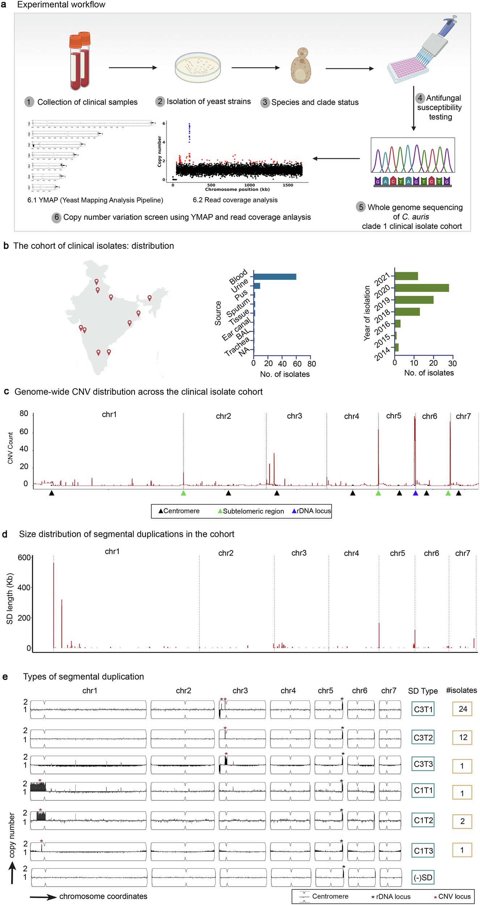
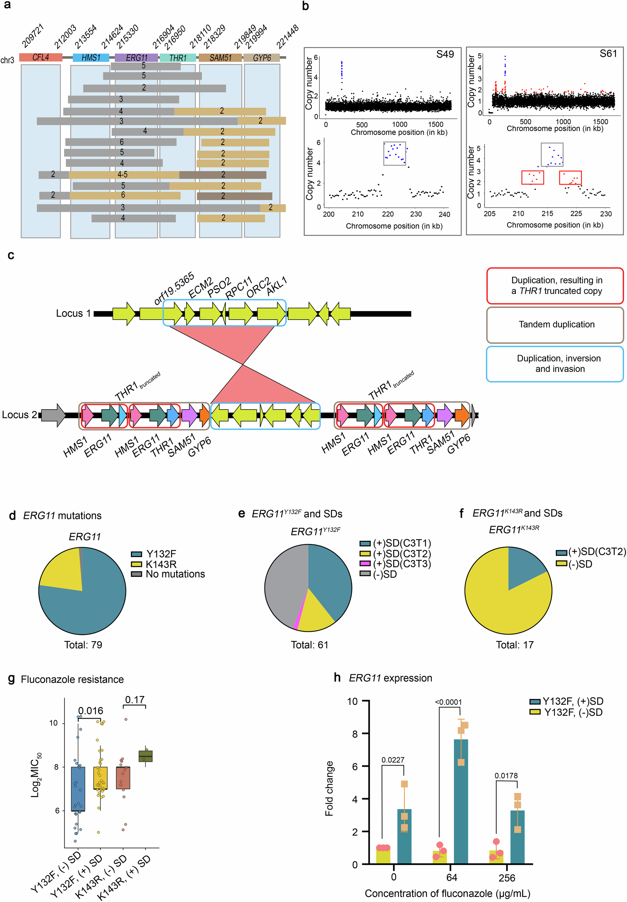
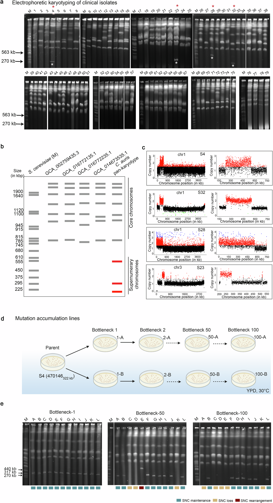
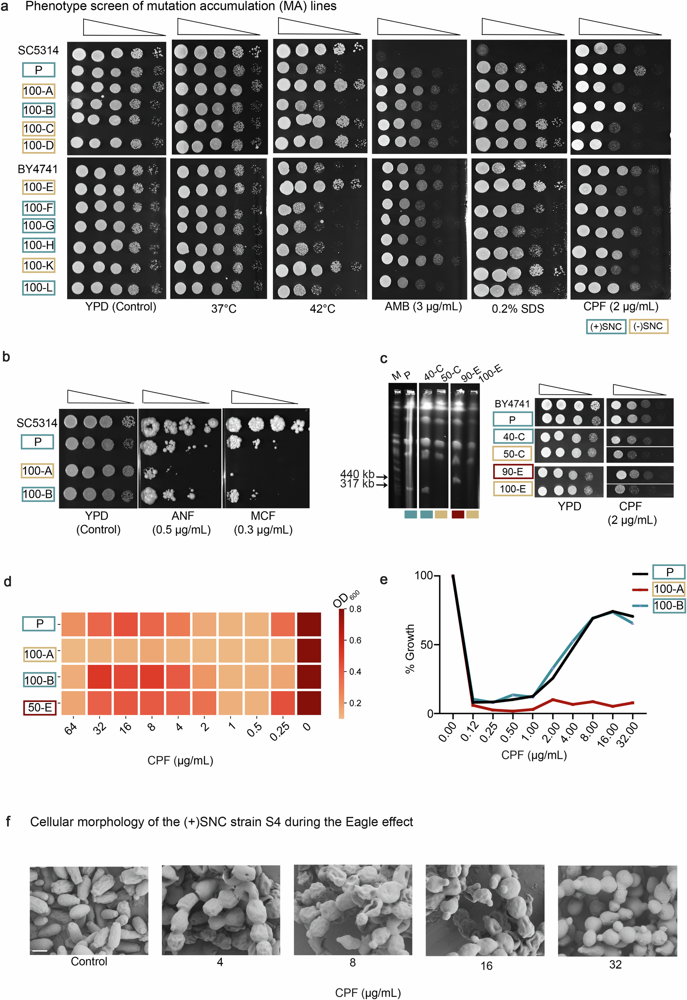
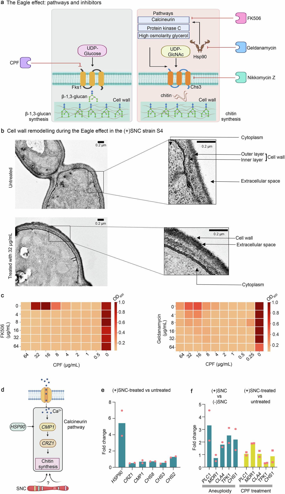
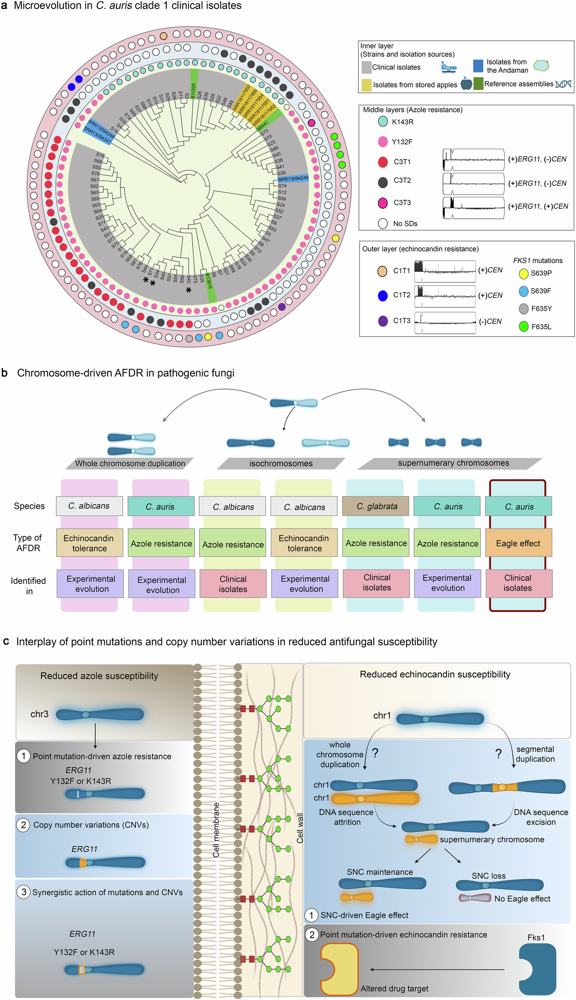

# Nature Communications：真菌通过染色体片段扩增获得耐药性——从 ERG11 基因剂量到超数染色体的形成

**一项针对79株耳念珠菌临床分离株的研究，把基因拷贝数、染色体形成与抗真菌药物反常生长联系了起来。**

一株真菌对药物的敏感性发生变化，通常会先想到抗性基因出现了点突变。但如果靶基因的序列没有进一步变化，只是它所在的染色体片段复制了几份，是否也能让药物失效？如果复制出来的DNA片段不再连接于原来的染色体，而是获得着丝粒与端粒，变成一条能够独立分离的小染色体，又会发生什么？

2026年7月10日，Narayanan等人在 *Nature Communications* 发表研究论文《Segmental duplications and supernumerary chromosomes drive antifungal drug resistance in *Candida auris*》。研究团队通过临床分离株群体基因组、拷贝数变异（CNV）分析、长读长测序、脉冲场凝胶电泳、单菌落瓶颈传代和药物表型实验，给出了两条基因组结构变化影响药物反应的路径。

一条路径发生在第3号染色体：包含唑类药物靶基因 *ERG11* 的区域反复扩增，与已知耐药相关点突变共同提高氟康唑等药物的最小抑菌浓度。另一条路径发生在第1号染色体：包含着丝粒的大片段重复能够形成额外小染色体，在高浓度棘白菌素类药物存在时，真菌反而恢复生长。这种反常生长被称为 Eagle effect。

这项研究的重要之处，在于作者没有把短读长测序观察到的“覆盖度升高”直接称为独立染色体，而是用真实的染色体带型、长读长结构证据以及额外染色体丢失前后的表型变化建立了多层验证链。

---

## 一、为什么真菌耐药不能只研究SNP？

耳念珠菌（*Candida auris*，部分分类体系采用 *Candidozyma auris*）是世界卫生组织列为优先关注对象的机会致病真菌，能够造成侵袭性感染和医院相关暴发。研究者长期关注它对唑类、棘白菌素类和多烯类抗真菌药物的敏感性变化。

针对唑类药物，经典机制包括编码药物靶酶的 *ERG11* 出现氨基酸替换、外排泵表达变化，以及相关代谢通路调整。棘白菌素类药物则作用于细胞壁β-1,3-葡聚糖合成过程，常见的获得性耐药与 *FKS1* 基因热点突变有关。

但是，点突变只是遗传变异的一种。**结构变异（structural variation，SV）和拷贝数变异（copy number variation，CNV）** 同样能够迅速改变基因组提供的功能剂量。对于通常呈单倍体状态、以无性增殖为主的耳念珠菌，这类变化可能尤其重要，因为它不必等待有性重组就能改变多个基因的拷贝数。

**片段重复（segmental duplication，SD）** 是一种产生CNV的结构事件。DNA复制或重组产生的额外拷贝可以留在原位、倒置到邻近区域，或经过更复杂的结构重排。而复制片段一旦成为携带着丝粒和端粒的独立DNA分子，就有可能以额外染色体的形式存在。

因此，单看SNP很可能漏掉一类重要的适应方式：药物选择并没有要求靶基因出现一个全新的点突变，也可能改变已有等位基因的拷贝数，或增加一组与细胞壁和应激响应有关的基因。

## 二、79株临床分离株揭示两处关键CNV热点

研究主体是79株来自印度的耳念珠菌临床分离株，均属于南亚分支clade 1，采样时间为2014—2021年，其中60株来自血液样本。作者结合全基因组短读长测序、YMAP和Control-FREEC识别染色体结构与拷贝数变化，同时记录各菌株的药物敏感性。

全基因组CNV图首先显示了预期中的高变区域，例如含rDNA的染色体区段、端粒附近区域和部分与逆转座子片段有关的区域。但除了这些熟悉的高变区，**第3号染色体出现了以 *ERG11* 为中心的反复扩增，第1号染色体则出现较大、涉及着丝粒的片段重复**。

*图1按染色体位置展示CNV热点以及不同结构重复类型。YMAP的拷贝数轨迹提供初筛信息，但它自身不能确定扩增片段是否已经成为独立染色体。*

作者将第3号染色体的重复分成C3T1、C3T2和C3T3等类型：有的只涉及 *ERG11* 附近的片段，有的同时跨越另一个热点，有的甚至延伸到着丝粒CEN3。第1号染色体的C1T1和C1T2等类型则具有不同的扩增边界，部分包含CEN1。

对公开环境分离株的再分析表明，部分在临床分离株中观察到的 *ERG11* 扩增模式，也存在于安达曼群岛和储藏苹果相关样本中；但作者没有在所研究的这些环境样本中发现第1号染色体对应的大片段扩增。这提示两类结构变异可能具有不同的发生频率或稳定性，尚不能推断它们绝对只在某一种环境出现。

在所分析的临床和环境样本合集中，作者报告第3号染色体的 *ERG11* 相关片段重复约占47%。这个比例反映文章规定的合并样本和筛选口径，不宜直接表述为“全部79株临床菌株中有47%独立产生了新扩增事件”，因为部分结构可能经共同祖先传播。

## 三、ERG11的扩增不是简单的“多一份”：复杂重复结构提高了唑类耐药

*ERG11* 编码羊毛甾醇14α-去甲基酶，是唑类抗真菌药物的重要作用靶点。增加靶基因剂量，可以在已有耐药相关变异背景下进一步改变药物抑制效果。

研究中的一个关键菌株是S61。短读长覆盖度显示，它在 *ERG11* 邻近区段出现阶梯状拷贝数增高。作者进一步开展长读长测序和组装，发现第3号染色体的两个热点经历了不止一次复制、倒置和局部重排。最终 *ERG11* 达到4份拷贝，并非简单的一次端对端串联。

断点在 *THR1*、B9J08_001445以及 *HMS1* 与 *CFL4* 之间的非编码区域附近较集中，周边还存在短串联重复和poly-A区段。论文提出，这些特征可能让染色体局部更容易发生重复；但“哪些DNA序列特征直接造成断裂”仍缺少独立机制验证。

*图2既包括染色体局部结构，也包括不同SNP背景下的药物MIC和qRT-PCR表达结果。读图时需要把“结构已经证实”与“该结构对表型的独立效应有多大”分开。*

在79株临床分离株中，耐药相关的两个主要 *ERG11* 氨基酸替换为Y132F和K143R。携带Y132F的菌株更常出现C3T1型扩增，而K143R背景下以C3T2为主。

最值得注意的是，**Y132F与 *ERG11* 片段扩增共同出现时，氟康唑和伏立康唑的MIC进一步升高**。在K143R背景下，作者没有观察到同样显著的组合效应，但该组样本数较少，不能把阴性结果理解为K143R拷贝数绝不重要。

表达量实验也支持剂量效应。S3携带Y132F但没有额外 *ERG11* 拷贝，而S61同样携带Y132F但有4个拷贝；S61具有更高的基础 *ERG11* 转录本水平，在一定氟康唑浓度下进一步提高。

这里仍有一个值得保留的证据边界：S3和S61不是同一遗传背景下只改变 *ERG11* 拷贝数的精准同基因对照，而且扩增区段覆盖其他基因。因此，作者的数据强力支持剂量增加与耐药增强有关，但还不能把全部增量效应都唯一归因于 *ERG11*，更不能据此断言断点附近的其他基因完全没有贡献。

## 四、第1号染色体扩增为何能变成真正的“额外染色体”？

从CNV到独立染色体，是这篇研究最关键的结构生物学跨越。

在79株临床分离株中，4株带有第1号染色体中包含CEN1的大片段重复。研究者使用CHEF脉冲场凝胶电泳分析这些菌株，发现4株都存在比7条核心染色体明显更小的额外染色体条带。

他们将这类小而非恒定存在的额外染色体定义为 **supernumerary chromosome（SNC，超数染色体）**。其中S4和S32有约300 kb的SNC，S28约550 kb；S23的额外条带约230 kb，但其长度与覆盖度推断的重复片段不完全一致，提示可能存在更复杂的重排。

*图3的关键不是重复出现的覆盖度峰，而是额外染色体在CHEF带型中真实可见，并且其存在、消失与测序中的重复拷贝数相互对应。*

**为何一个重复片段能够独立存在？** 稳定的真核染色体通常需要着丝粒完成有丝分裂分离，同时需要端粒保护线性染色体末端。

作者针对额外染色体进行了三方面的验证。首先，DNA测序的局部拷贝数提升对应第1号染色体的复制片段；其次，qPCR验证了这些样本的CEN1拷贝数增加；再次，ONT长读长证据显示重复片段具有在原始参考中不存在的端粒—重复片段连接（TEL–SD junction）。

这些证据共同支持：**包含着丝粒的染色体片段在获得端粒后，可以成为独立存在的超数染色体**。

但需要严格区分术语。这里的SNC主要来自核心染色体片段重复；它不等于一条来源不明、具有长期独立演化历史的典型附属染色体（accessory chromosome）。不同物种中“超数染色体”“附属染色体”“B染色体”的定义有重合，也存在结构与演化来源的差别。理解这一点，对解释更复杂丝状真菌的覆盖度异常尤其重要。

## 五、12条突变积累谱系揭示：这条染色体可以稳定维持，也可以自行丢失

作者没有停留在临床分离株之间的横向比较。为了观察超数染色体能否随无性繁殖维持，研究团队从带有约300 kb SNC的S4菌株出发，建立12条独立的突变积累（mutation accumulation，MA）谱系。

这些谱系在没有抗真菌药物的YPD培养条件下，通过连续单菌落瓶颈传代，整个实验覆盖约1500代细胞增殖。作者在第1、50和100个瓶颈节点检查染色体带型。

开始时12条谱系都带有SNC。第50个瓶颈已有3条谱系丢失了SNC，另有一条出现约500 kb的重排型小染色体；到第100个瓶颈，该重排染色体也已消失，最终有5条谱系不再携带SNC。

全基因组重测序证实，保留SNC的谱系仍携带对应的片段重复，失去SNC的谱系同步失去这部分重复。个别额外条带长度变化，可能与其和原有核心染色体之间的重组有关。

这个实验有两层意义。第一，它说明SNC能够在不加药的条件下经历许多代无性增殖而维持，是真实可遗传的染色体实体。第二，它又比核心染色体更容易丢失和重排，因此可能提供一种 **可逆、相对快速的基因剂量调节路径**。

这里的“可逆”指培养实验中可以观察到额外染色体自然丢失；不是说临床环境中任何菌株都能在停药后迅速、必然恢复敏感。

## 六、真正的功能验证：失去SNC，反常药物生长也随之消失

作者比较MA传代后带有SNC和不带SNC的菌株，寻找与额外染色体有关的生理效应。

经过多种抗真菌药物、化学压力和温度条件筛查，最突出的优势出现在棘白菌素类药物卡泊芬净（caspofungin，CPF）存在时。带SNC的菌株在特定浓度下更容易继续生长；相反，在较高温度或SDS胁迫下，带SNC也可能有额外的生长成本。

进一步测试米卡芬净和阿尼芬净，发现相近的敏感性变化，说明这种效应不限于单一棘白菌素分子。

*图4包含药物点样、剂量反应曲线、带型对应以及显微形态。最有说服力的是同一突变积累谱系在SNC丢失前后的连续比较。*

通常，药物浓度增高应使微生物生长进一步降低。但在某些真菌中，棘白菌素达到一定高浓度后，生长反而重新出现，这就是 **Eagle effect（反常生长效应）**。它不应与传统意义上具有稳定升高MIC的耐药表型直接画等号。

研究中，在相对较低浓度的卡泊芬净下，带SNC菌株仍可受抑制；而在更高、超过MIC的药物浓度下，它们能够恢复部分生长。失去SNC的MA后代则失去这种反常生长优势。

这是比“有SNC菌株的MIC高一点”更具体、也更容易通过常规MIC检测遗漏的药物反应模式。**常规MIC单点判定不一定能识别超MIC药物区间的生长回升**。

需要注意，SNC丢失前后虽然遗传背景更接近，但长期传代仍可能产生其他变异；作者结合多个独立谱系、染色体变化和表型恢复来加强关联。若要把影响归因于某个具体重复基因，仍需要直接的等位基因编辑或重建实验。

## 七、为什么药物越多，有时反而越能生长？细胞壁补偿提供线索

卡泊芬净等棘白菌素通过抑制β-1,3-葡聚糖合成，破坏真菌细胞壁。当真菌面对这样的压力，细胞壁修复、几丁质合成以及应激信号通路可能被激活。

作者观察到，出现Eagle effect的SNC阳性细胞，细胞形态、聚集模式和细胞壁超微结构都发生改变。电镜显示药物处理后细胞壁增厚、层次结构变得不清晰，几丁质相关染色信号也增强。

*图5把细胞壁变化、抑制剂联合处理和基因表达放在一起，支持一种通过补偿性应激响应维持生长的机制。其示意通路不意味着每一条箭头都已在耳念珠菌中逐一完成遗传验证。*

药物联合实验进一步发现，抑制calcineurin的FK506、抑制Hsp90的geldanamycin，以及影响几丁质合成的nikkomycin Z，都能抑制Eagle effect，并与卡泊芬净表现出协同作用。这支持Hsp90–calcineurin信号和细胞壁补偿在反常生长中的作用。

qRT-PCR也发现，高浓度卡泊芬净处理时 *HSP90* 的转录水平升高。S4衍生SNC中的重复区段含147个基因，其中具有细胞壁组织、化学胁迫响应和信号转导相关功能的基因。部分候选基因，包括 *CHS1* 同源基因、*CLA4*、*TPK1* 和 *PLC1*，在带有SNC的背景下上调。

由此出现一个合理解释：**额外染色体通过同时提高多个应激或细胞壁相关基因的剂量，使细胞更容易启动补偿性生长**。

但论文目前还没有锁定一条足以独立产生Eagle effect的最小基因片段，也未排除多个基因协同或细胞整体非整倍性应激反应的贡献。因此，可以说作者发现了SNC驱动药物表型的染色体基础，并提供了下游应激机制证据；还不能把147个基因中的某一个直接定为已验证的唯一驱动因子。

这些抑制剂的研究属于实验室机制分析，不代表已经确立可直接临床应用的联合治疗方案。

## 八、把SNP、CNV和染色体放在同一棵树上，才看得见耐药微进化

最后，研究者利用全基因组双等位SNP构建clade 1菌株间的系统发育关系，并把 *ERG11* 变异、*FKS1* 变异、不同SD结构、SNC状态以及临床和环境样本来源逐一映射到树上。

*图6对分支内结构重复的克隆扩张与不同分支中的独立起源进行了区分。图中的综合机制图是研究结果的概括，不能把所有组合解释为同一株菌内必然顺序发生的事件。*

有两个结果尤其重要。

第3号染色体的C3T1型重复更集中于相近的系统发育分支，提示它可能在一个共同祖先中出现，随后随克隆群体扩张；C3T2则散布于更多分支，更符合重复发生或多个独立演化事件。

第1号染色体SNC更加稀少，出现在不同遗传背景中，支持至少两次独立起源。带SNC的菌株与携带 *FKS1* 热点突变的菌株在样本中未出现重叠，而 *FKS1* 热点突变解释了10株临床分离株中的棘白菌素耐药。

研究还找到3株同时带有 *ERG11* 点突变、其区域拷贝数扩增和 *FKS1* 点突变的菌株。其中2株同时具有较高的唑类与棘白菌素MIC，说明 **不同层次的遗传改变能够在同一遗传背景中累积，构成多药耐受或耐药表型**。

“克隆扩张”和“独立发生”必须分清：如果某个SD类型在50株样本中出现，但这些样本属于同一个扩张的克隆谱系，它们不能被当作50次独立的结构突变事件。

## 九、这项研究有什么独特创新？又有哪些边界？

从研究设计看，论文的强项是把结构证据、遗传稳定性和功能表型连了起来。

第一，作者不是只用CNV热图筛出候选。第3号染色体的复杂扩增得到长读长组装支持，第1号染色体的SNC得到CHEF、CEN1拷贝数和TEL–SD连接共同支持。这使“额外DNA剂量”与“额外染色体实体”的概念能够分开。

第二，MA实验把临床群体中的结构差异带入共同遗传背景，发现SNC可保留、重排和丢失；在发生丢失的谱系里，Eagle effect也随之改变，为染色体—表型关联提供了更直接的证据。

第三，药物表型不只看MIC，还检查了超MIC浓度下的生长模式。这对于研究耐药、耐受、异质性耐药和反常生长之间的差异非常关键。

第四，研究把重复结构映射到群体系统树，能够部分区分某种结构重复在共同祖先中出现后扩张，与在不同分支多次产生的情况。

但也有需要明确的局限。

**其一，样本主体集中于南亚clade 1。** 79株临床分离株提供了较深入的组内分析，但不能据此推断全球所有耳念珠菌谱系的SNC发生比例。

**其二，独立SNC的临床例数很少。** 最初只在4株临床分离株中发现包含CEN1的相关结构。针对Eagle effect的机制证据虽有传代对照支持，但还需要更多地理谱系和临床背景验证其普遍性。

**其三，额外染色体的核心驱动基因尚未确定。** 147个重复区段基因中的候选响应因子具有合理性，但多基因剂量、染色体重排效应或非整倍性应激仍可能共同贡献表型。

**其四，临床治疗结局尚未在本研究中得到直接证明。** 体外Eagle effect提示常规药敏判定可能遗漏的生长模式，但它能否以及在多大程度上改变不同患者的治疗结局，需要更直接的体内或临床证据。

此外，论文有时将CNV称为“非点突变驱动”或“非经典突变机制”，从严格遗传学角度，结构变异本身仍然属于基因组改变，不能理解为没有发生DNA变异。

## 十、对附属染色体与食用菌群体基因组研究的启发

这篇文章很适合用来反思一个常见但危险的逻辑跳跃：**在某条contig上看到2倍或更高覆盖度，就认为它是一条附属染色体。**

覆盖度变化首先说明相对于参考序列的DNA剂量发生变化。它可能来自局部串联重复、倒置重复、不同核型的相对比例、倍性变化、旁系同源序列错误比对，也可能来自真正独立的额外染色体。

本研究展示了更完整的证据阶梯：

1. 利用窗口覆盖度和CNV算法确定重复片段的边界、拷贝数和样本频率；
2. 通过长读长组装或跨断点reads确定片段排列方向、复制次数以及与其他染色体的连接关系；
3. 搜索着丝粒、端粒和独特的TEL–SD接头，为独立染色体模型提供结构支持；
4. 使用CHEF等正交核型证据验证是否确实存在独立DNA实体；若无法获得实验材料，应明确降低对“独立染色体”的结论强度；
5. 将不同样本或传代谱系的染色体结构与功能表型比较，寻找重复发生、保留、丢失及其对应的表型变化；
6. 最后把这些变化映射到核心基因组系统树上，判断其与群体分化、克隆扩张和潜在独立起源的关系。

对于双核或异核的担子菌，**还必须额外考虑两个核的等位基因比例与相对核剂量**。而对单倍体的耳念珠菌，常规基线拷贝数通常为1，因此在单一参考上观察到2倍剂量的含义相对直观。这两种生物学背景不能简单套用同一个拷贝数阈值。

这并不是说所有附属染色体研究都必须具备与临床病原真菌完全相同的证据组合。不同物种的染色体结构、重复含量、交配系统和可获得的实验材料不同，但 **区分“片段拷贝增加”“独立SNC”和“长期演化的附属染色体”** 应当是解释时的基本要求。

## 结语

这项研究揭示了耳念珠菌对抗真菌药物的两种染色体结构适应方式：第3号染色体的 *ERG11* 相关片段扩增能够强化已有点突变背景下的唑类耐药；第1号染色体的大型着丝粒片段重复能够在获得端粒后形成额外小染色体，并参与棘白菌素高浓度条件下的反常生长。

最有说服力的是证据链的完整性：群体CNV筛查发现结构热点，长读长解析复杂断点，CHEF证明独立染色体的存在，突变积累实验观察染色体的丢失，药物实验则证明这种丢失对应特定药物反应的改变。

它提示我们，真菌基因组进化不仅发生在SNP位点，也发生在基因剂量、染色体结构及其可逆变化之中。而这些结构变化是否真正驱动适应，最终仍需要把DNA证据与细胞行为和功能实验相连接。

---

**论文信息**

Narayanan A, Joshi S, Harchand R, et al. (2026). Segmental duplications and supernumerary chromosomes drive antifungal drug resistance in *Candida auris*. *Nature Communications* **17**, 8544.

DOI：https://doi.org/10.1038/s41467-026-75437-3

论文全文：https://www.nature.com/articles/s41467-026-75437-3

**开放许可及转载注意：** 该论文采用 **CC BY-NC-ND 4.0**（署名—非商业性使用—禁止演绎）。文内原始Fig.1—6按出版方完整、未经修改的图片文件展示；非商业传播应保留作者与出处，不得裁切或重新绘制后以原图名义转载。若公众号文章或其他用途涉及商业使用、付费推广或改编，需先核查并获得相应授权。部分图包含BioRender或地图制作元素，还应遵守原图标示的第三方许可。