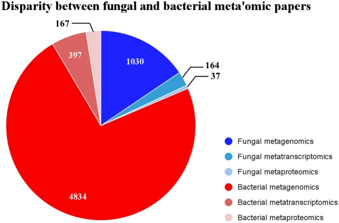
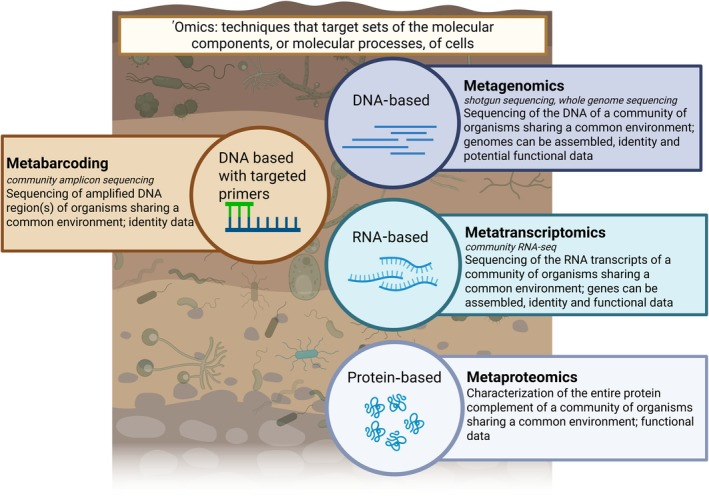
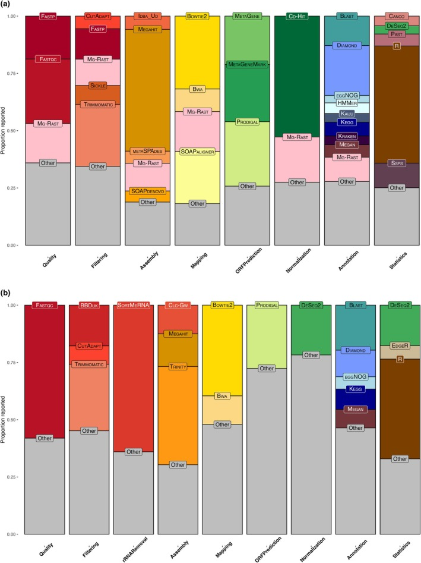
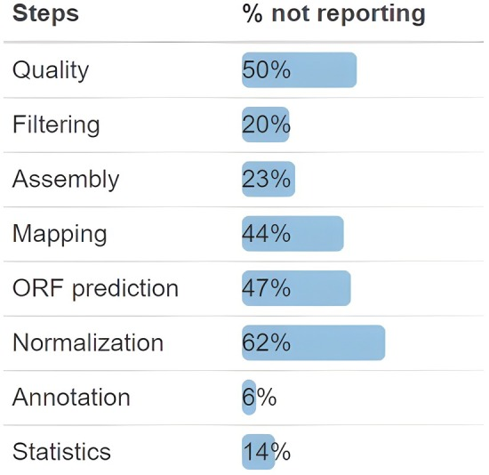
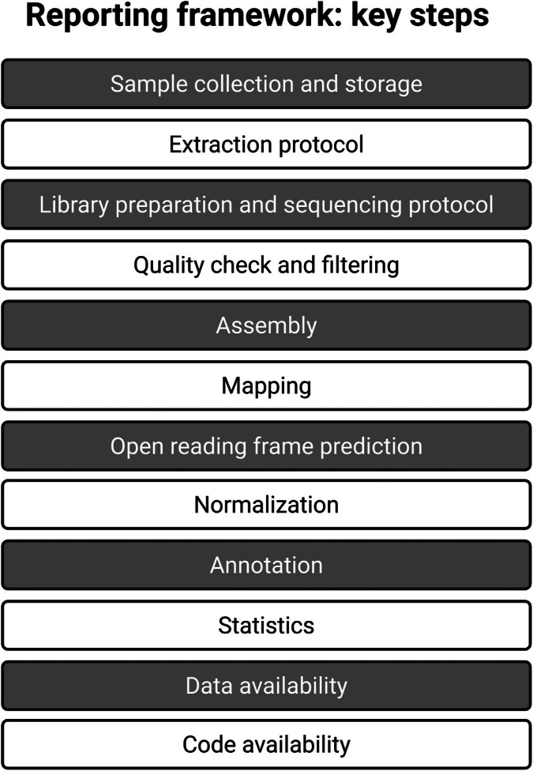

# New Phytologist：315篇研究揭示真菌生态组学的短板——我们越来越擅长测序，却还没充分回答真菌在生态系统中做了什么

**从宏基因组、宏转录组到宏蛋白质组：一篇关于科学问题、方法选择和可重复性的综述**

如果在森林土壤中检测到大量外生菌根真菌，能否据此判断它们促进了植物吸收氮磷？如果土壤宏基因组发现了丰富的碳降解酶基因，是否说明这些微生物正在加快碳释放？如果两组样本的真菌群落组成不同，能否进一步推断土壤碳储量或植物生长的变化？

这些问题看似都可以用测序来研究，但从基因和物种的“存在”，到基因的“表达”，再到酶的实际作用与生态过程，中间仍有很长的证据链。

2026年1月11日，*New Phytologist* 在线发表综述 **“Fungal ecology in the age of 'omics”**。由Brontë R. Shelton等13位作者完成的这篇文章，把视角放在地下植物—真菌生态学：组学技术已经能够产生海量数据，为什么我们对真菌在生态系统中的作用仍然缺少充分认识？

作者对2015—2025年的相关研究进行了文献调查，比较了宏基因组、宏转录组和宏蛋白质组在真菌生态学中的应用情况，统计常用生物信息学软件及其报告完整性，并提出一套最低限度的数据分析报告框架。

本文为**综述与文献方法调查**，其中的软件使用频率反映领域现状，并非作者用统一数据集得出的性能排行榜。

---

## 一、研究数量的差距，比想象中更大

研究者首先检索2015年1月至2025年1月Web of Science中与土壤、植物、真菌或细菌有关的宏组学论文。初步对比显示，植物—土壤背景下**细菌组学相关论文数量超过真菌论文的4倍**。

在他们最初的筛选范围中，真菌研究又明显偏向宏基因组：约86%涉及宏基因组，涉及宏转录组和宏蛋白质组的比例分别约为13%和3%。这里各技术可以在同一论文中共同出现，比例不应机械理解为互斥的三类。

*图1。蓝色代表真菌、红色代表细菌研究。这是基于特定关键词与Web of Science收录文献得到的分布，反映检索范围内的研究倾向，并非全球所有相关研究的完整计数。*

为了进一步分析流程，作者又检索并筛选了真菌宏组学研究：**1,141篇初始结果经过人工核查，保留315篇**。其中245篇涉及宏基因组，59篇涉及宏转录组，13篇涉及宏蛋白质组。研究类别存在重叠，所以245、59和13不需要相加等于315。

由于宏蛋白质组文献太少，后续详细的软件使用统计主要依据涉及宏基因组或宏转录组的**304篇相关文献**。

研究的价值因此非常具体：它不只是笼统指出“真菌研究不足”，而是展示了不同技术的数据积累、实际应用和方法报告之间的结构性差距。

## 二、检测到了什么、正在表达什么、真正产生了什么效果

论文用一张概念图梳理了常被混用的技术名词。

*图2。原文由BioRender绘制。图中区分不同技术所观察的分子层级；ITS扩增子等宏条形码技术不等同于shotgun宏基因组。*

**宏条形码测序（metabarcoding）**通常利用ITS或其他标记区域描述特定生物类群的组成。它能帮助回答“有哪些真菌”，但不同物种的拷贝数、引物匹配和扩增效率会影响相对丰度。

**宏基因组（metagenomics）**分析环境中的DNA，可以调查微生物及其功能基因库。例如，样本中是否具有糖苷水解酶、木质素相关氧化还原酶或养分转运基因。它给出的是遗传潜能，不能直接确认采样时这些基因正在表达。

**宏转录组（metatranscriptomics）**检测环境RNA，能观察某个时间点群落中哪些基因处于转录状态。它在解释环境变化、微生物竞争和宿主互作方面提供了新的信息，但RNA丰度仍然受到细胞数量、RNA稳定性和测序偏倚影响。

**宏蛋白质组（metaproteomics）**进一步接近实际的功能执行层，能够观察到样本中出现哪些蛋白质。不过，检测到蛋白质也不自动等于测得酶催化速率，真正的活性和过程通量仍需要相应测定。

这几层信息互为补充。假如某种真菌携带纤维素降解酶编码基因，宏转录组检测到该基因上调，宏蛋白质组检测到相关蛋白，同时滤纸降解或酶活实验也显示增加，那么关于木质纤维素降解贡献的推断才更完整。

**论文特别强调，科学问题应决定技术组合。** 如果真正要测量的是土壤呼吸、菌根侵染率或碳库变化，实验测量与理化指标仍然不可缺少。

## 三、真菌的“暗物种”，不只是数据库里没有名字

真菌生态学的一个长期难题是参考数据库不完整。作者引用的既往估计显示，截至2020年前后，约30%的已命名真菌物种可以找到某种序列数据；若以全球预期真菌多样性为分母，有可识别序列的比例可能只有1%—6%。

需要注意：这些是论文引用的**历史估计**，而且“存在某种序列”常常只是有ITS条形码，不意味着已经拥有高质量基因组。

很多真菌首先通过环境DNA被发现，缺少对应的形态鉴定材料、培养物或正式物种名称，被统称为“暗物种”或“暗类群”（dark taxa）。反过来，传统分类学中已有名称和标本的种，也可能缺乏可以与它们可靠连接的参考序列。

这会形成一个循环：数据库里没有近缘参考，环境reads难以准确命名；无法准确归属，便不容易判断特定功能由哪个真菌类群承担；缺乏形态、培养和功能证据，又会进一步限制数据库改善。

作者建议扩大真菌基因组和功能数据库，并将宏基因组与宏转录组结合，用遗传潜能和表达信息共同研究暗类群的生态角色。

这种思路有明确的边界。某个未知转录本能够匹配一种酶家族，并不足以直接证明该暗类群属于特定生态营养型；共生、腐生或寄生等生态策略的认定，还需要基因组合、环境背景及独立生物学证据。

## 四、304篇文献统计：大家究竟在用哪些软件？

论文对质量检查、质控过滤、rRNA去除、组装、reads回贴、ORF预测、定量/标准化、注释和统计分析等步骤逐一统计。

在**宏基因组**文献中，各步骤最常见的报告工具包括：FastQC（质量检查，28.1%）、Trimmomatic（过滤，27%）、MEGAHIT（组装，53.1%）、Bowtie2（mapping，31.8%）、Prodigal（ORF预测，28.1%）、CD-HIT（原文归入normalization，52.7%）、DIAMOND（注释，21.8%）和R（统计，51.1%）。

在**宏转录组**文献中，常见工具则为：FastQC（58%）、Trimmomatic（29%）、SortMeRNA（rRNA去除，64%）、Trinity（组装，42.8%）、Bowtie2（mapping，39.5%）、Prodigal（ORF预测，27.6%）、DESeq2（原文归入normalization，21.7%）、BLAST（注释，19.6%）和R（统计，43.5%）。

*图3。a图为宏基因组，b图为宏转录组。比例基于各分析步骤中被报告的工具信息，不能理解为这些软件在统一benchmark中的准确率。*

图3有三点尤其值得留意。

第一，某些流程确实在逐渐收敛。比如宏基因组组装，MEGAHIT已经非常常见；但宏转录组仍有很多不同实现。论文在数量不多的宏转录组文献中，统计到**20种不同的质控过滤软件和16种组装软件**。

第二，流行与适合真菌是两回事。Prodigal主要面向原核基因预测，不能因为它在混合群落研究中被频繁使用，就直接把它作为高质量真核基因结构注释的首选。真菌含有内含子、可变剪接及复杂基因结构，预测和注释通常需要真核导向的方法。作者指出BUSCO和BRAKER2等具有明确真核应用价值的工具，在相关研究中报告得仍不多。

第三，同一环节的统计名称未必代表完全相同的计算任务。以CD-HIT为例，它主要完成序列聚类与去冗余；将它简单视为表达量或丰度的统计标准化方法，会产生概念混淆。这也反映出“软件用了什么”仍不足以确保不同研究之间能够直接比较。

论文引用其他比较研究提示，Kraken2、MetaPhlAn4等在微生物组领域广泛使用的分类工具，未必适合真菌覆盖不足的复杂环境数据。这不是本文作者重新跑出的工具准确度排名；最终选择仍要看参考数据库、序列类型与研究目标。

## 五、最大的可重复性问题：方法部分经常说不清楚

这是整篇综述最有警示意义的部分。

作者发现，论文通常会报告采样、核酸提取和测序平台，却经常省略分析中的关键参数与工具名称。**质量检查、ORF预测和归一化等步骤，报告具体软件的论文比例不足50%。**

质量过滤、组装和reads mapping三个环节，有大约20%—50%的论文没有报告具体程序。相对较好的注释与统计环节，也分别有约6%和15%的论文缺失软件报告。

*图5。这里展示的是方法报告缺失的比例，并不直接证明相应分析一定做错；但信息缺失会阻碍第三方复现、比较和复用。*

为什么这些缺失有实质影响？

同一份宏基因组数据，contig最小长度与组装软件不同，最终保留的低丰度序列集合就可能变化；同一份宏转录组数据，rRNA过滤、ORF预测与多重比对处理不同，会改变进入功能比较的转录本；使用不同的参考库版本，甚至可能把一些基因归到不同物种或功能家族。

此外，只报告“使用R进行分析”并不能说明统计检验、距离矩阵、离散度处理与多重比较策略。缺少参数和软件版本时，其他研究者即使取得全部原始测序数据，也未必能够重现发表结果。

## 六、作者提出一套最低限度的报告框架

鉴于分析技术仍在快速变化，作者没有要求全领域立刻统一成一条固定软件流水线。他们呼吁先把**可重复报告**建立起来。

论文提出四项基础要求：

1. **采样和保存**：记录样本位置、时间、处理、保存方式与重要环境变量；
2. **软件和参数**：逐步记录数据质控、组装、比对、ORF预测、定量、注释和统计的程序、版本及关键阈值；
3. **序列数据存放**：明确测序数据及相关产物的存储库与可访问编号；
4. **代码可访问性**：公开用于分析的自编脚本及其获取位置。

*图4。论文对采样、流程参数、数据存储和脚本开放提出了最低报告要求，并建议未来由领域共同体不断细化。原图由BioRender绘制。*

这套建议的意义在于，允许研究者根据问题采用不同软件，同时保证别人能够理解一个研究的结果是怎样得到的。

对实际项目而言，可以进一步记录参考数据库的下载日期与版本、质控前后reads数量、非真菌污染过滤、功能注释的匹配阈值、低丰度过滤标准、功能归属的不确定性，以及每个丰度指标的分母。这些属于本文解读补充的**操作性建议**，不应误认为四项都是原文逐字规定。

## 七、宏组学无法替代的“传统方法”，反而决定了生态结论强弱

论文把大量篇幅留给一个容易被忽视的问题：测序能告诉我们很多分子信息，但生态学最终往往关心的是生态过程。

以土壤碳循环为例，宏基因组可以描述潜在的碳代谢基因库，宏转录组可以判断相关基因是否表达，宏蛋白质组可以检测降解酶等蛋白。但如果要说土壤碳释放增加、某种处理提高了长期碳封存，仍需要土壤呼吸、碳组分或长期观测数据。

作者举出的传统测量包括：磷脂脂肪酸分析（PLFA）与酯键脂肪酸甲酯分析（EL-FAME）用于补充微生物生物量背景；红外气体分析用于土壤呼吸；颗粒有机碳（POC）与矿物结合有机碳（MAOC）区分碳库；根系染色和显微观察确认菌根定殖；酶活测定提供功能执行的直接证据。

这里需要区分不同技术的测量对象。PLFA通常给出特定类群的生物量估计，并非对所有真菌物种进行精确绝对计数；宏蛋白质组检测蛋白丰度，也不自动等于测到真实环境中的酶催化速率。组合不同数据时，关键是确认各指标是否在回答同一个生态学问题。

论文表1针对气候变化、植物入侵、除草剂应用和微生物接种剂提出了多组组合方案。例如，研究真菌接种剂是否改变土壤碳过程，可以结合宏转录组、POC/MAOC与微生物量测定；研究植物入侵是否改变土壤呼吸，可以把宏转录组的表达变化与红外气体分析联系起来。

这些例子提示，**功能推断需要与过程测量相连接**。更丰富的测序层级能够提升机制解释的分辨率，但不能自动填补缺失的生态过程证据。

## 八、未来的机会：功能数据库、真核友好的流程与跨尺度观测

作者认为，真菌宏组学的发展需要同时改善参考基因组、功能注释、实验设计和结果报告。

随着高质量真菌基因组不断增加，早期难以分类的环境序列有机会被重新归属；长读长与更适合真核生物的注释策略，可以帮助解析复杂基因结构；AI和其他计算方法可以为未知蛋白提供新的功能线索。

不过，数据库的价值仍取决于底层证据。一个蛋白被注释为具有某种酶家族结构，不意味着相应活性已在该真菌或环境中得到实验确认；仅凭某个转录本的变化，也很难从单次采样推断一个生态过程的长期变化。

论文尤其强调**时间与空间重复**。宏组学通常捕获一个具体条件下的快照，缺少跨季节、跨地点或扰动前后重复，便难以建立稳健的生态规律。未来真正有价值的数据集，需要在不同尺度上兼顾群落、功能和过程指标。

## 九、给真菌群体组学和微生物组研究者的启示

这篇综述很适合用来重新检查已经完成或正在运行的土壤/菌床宏组学项目。

如果研究的是植物—真菌互作，可以先把科学问题拆解为“群落组成变化”“基因潜能变化”“实际表达变化”与“生态过程变化”，避免使用一种数据回答多个层级的问题。

如果研究的是木质纤维素降解功能，可以清楚区分CAZyme基因存在、CAZyme转录、相关蛋白和酶活之间的证据等级，并检查保守酶基因在细菌、真菌之间是否存在错误归属。

如果研究的是土壤宏基因组的真菌物种多样性，可以优先审视真菌参考库是否覆盖相关类群，警惕原核导向ORF预测、短contig分类和低覆盖组装造成的系统性偏差。

如果研究的最终目的是解释产量、养分循环或碳储存，那么与宏组学匹配的表型、环境和实验数据往往会决定研究能否从“关联”走向更有力的机制解释。

这里的应用建议是基于论文论点进行的延伸，未声称作者已经验证某个特定的真菌群体组学分析方案。

## 结语

*Fungal ecology in the age of 'omics* 的价值在于，把真菌生态学界已经存在的一些问题进行了量化：研究数量远少于细菌，功能层面的宏转录组和宏蛋白质组研究尤其稀缺；数百篇研究虽然采用了复杂的生物信息学流程，但软件、参数和标准化信息仍经常报告不足。

作者提出的方向很清楚：扩大真菌基因组与功能参考资源，让实验测量与宏组学相互验证，并建立能够被复现、比较和重复使用的方法报告体系。

对于希望把组学研究推进到生态机制层面的真菌研究者，这既是一份技术参考，也是一份研究设计清单。测序技术正在持续扩展观察能力，下一步需要更扎实地把分子信号与真菌真实的生态作用连接起来。

---

**论文信息**

Shelton BR, Larrere J, Yusta Belsham D, Omacini M, Argüelles-Moyao A, Buscardo E, et al. (2026). Fungal ecology in the age of 'omics. *New Phytologist* 250(2): 822–833. First published 11 January 2026.

DOI：https://doi.org/10.1111/nph.70900

原文：https://nph.onlinelibrary.wiley.com/doi/10.1111/nph.70900

PMC：https://pmc.ncbi.nlm.nih.gov/articles/PMC13000982/

**图片与授权说明：** 原论文采用CC BY开放许可，本文按原编号引用原始主文Fig.1–5并保留文献来源。Fig.2与Fig.4原由BioRender制作，转载时需同时尊重图内可能存在的第三方素材与平台授权规定。