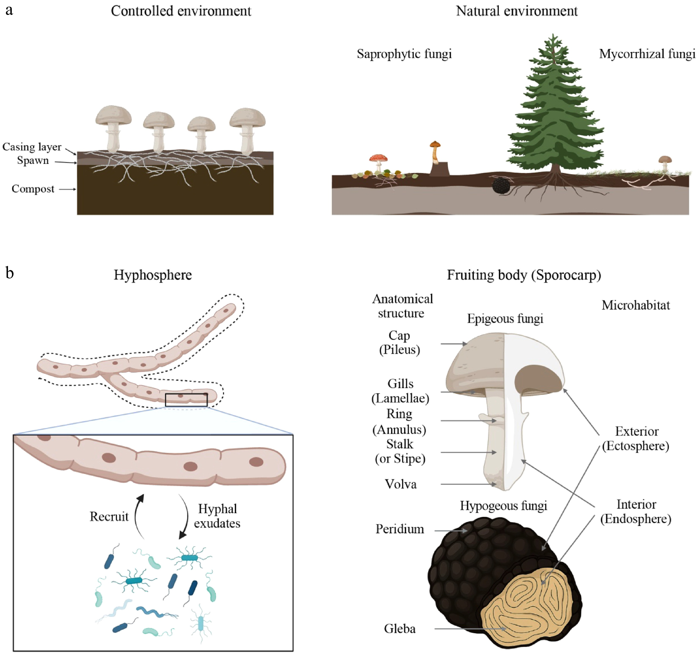
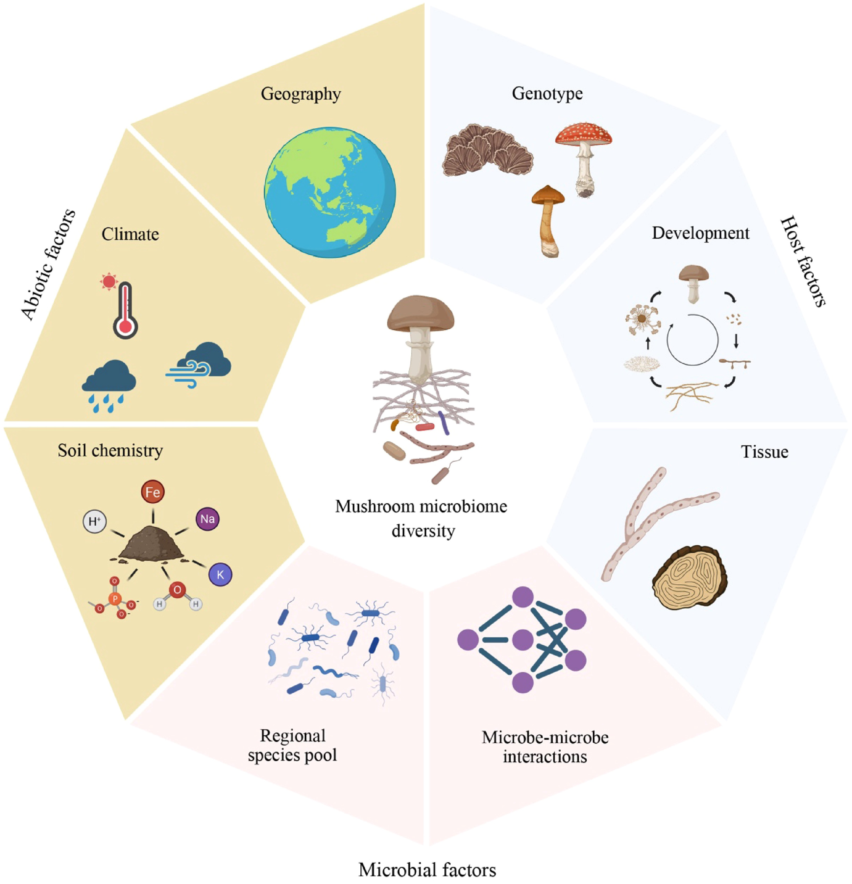
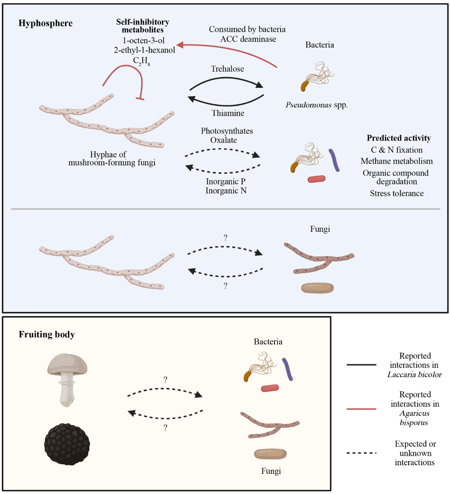
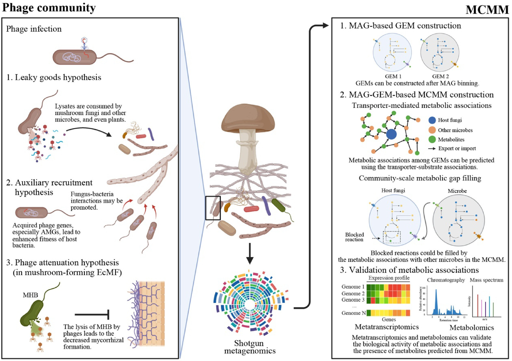

# Panfungi综述：蘑菇也有自己的微生物组——从菌丝际到子实体，谁在影响食用菌的生长与产量？

**一篇综述串联蘑菇菌丝分泌物、细菌与微真菌群落、促生与拮抗机制，并提出噬菌体和群落代谢模型两个新方向。**

提到微生物组，我们很容易想到植物根际、动物肠道或者土壤。但是，对一朵正在形成的蘑菇来说，菌丝周围的土壤、基质与子实体本身，同样生活着大量细菌和其他真菌。这些微生物可能利用蘑菇分泌的糖和有机酸，也可能反过来提供营养、促进原基形成，或者竞争营养、诱发病害。

2026年1月28日，首尔大学In Hyup Bae、Hyun Kim和Yong-Hwan Lee在新期刊*Panfungi*发表综述**《Microbiomes in mushroom-forming fungi》**，梳理了蘑菇形成真菌（mushroom-forming fungi）相关微生物群落的组成、生态位分化、功能互作和应用前景。

这是一篇**综合性综述**：作者整理既有研究并讨论未来方法；其中的微生物作用机制来自不同论文，噬菌体和群落代谢模型则主要是提出的研究框架。阅读时应区分“已经有培养或分子实验证据的互作”与“基于多组学或生态学观察提出的可能机制”。

## 一、蘑菇形成真菌本身也是一种“微生物组宿主”

植物拥有根际微生物组，真菌同样可以通过营养获取、菌丝延伸和代谢物分泌改变周围微环境。作者首先区分了两个容易混淆的空间概念。

**菌丝际（hyphosphere）**指直接受到真菌菌丝影响的邻近微环境，类似植物根际。菌丝分泌的葡萄糖、果糖、海藻糖、有机酸、氨基酸和多酚等物质，可以成为周围微生物的碳源或信号分子。**菌丝体影响区（mycosphere）**的范围更广，指受到菌丝网络及其代谢活动影响的土壤或基质环境。本文沿用综述的说明：在不少既往蘑菇研究中，并未严格分离紧贴菌丝的土壤，因此经常把mycosphere当作hyphosphere的近似研究对象。

与此同时，成熟子实体形成了另一类微环境。菌盖、菌褶或菌孔、菌柄等组织的表面及内部，都可能承载与土壤不同的微生物群落。论文把子实体外表面称为**ectosphere**，内部称为**endosphere**。

*图1。栽培体系包括堆肥、菌种和覆土层，野生腐生真菌与菌根真菌则在凋落物、腐殖层或树木根际生活。右侧区分了菌丝际与子实体表面/内部微环境。原图由BioRender制作。*

这种划分很重要。一个培养料样本中的微生物，与同一菌株菌盖内部检测到的微生物，其来源、接触方式和功能角色可能完全不同。把它们统称为“蘑菇菌群”，容易丢失决定性空间信息。

## 二、不同蘑菇的菌丝周围，常能找到相似的细菌

综述汇总了自然栖息地和栽培体系中的微生物组成。野生外生菌根真菌与腐生真菌的菌丝体影响区，常见的优势细菌门包括**Pseudomonadota（旧称Proteobacteria）、Acidobacteriota和Actinomycetota（旧称Actinobacteria）**。不同宿主、地区和采样时间之间的比例差异很大。

属层面，**Bradyrhizobium、Pseudomonas、Burkholderia相关类群、Mycobacterium、Bacillus和Paenibacillus**在多项研究中被报道富集。这些重复出现的类群提示，菌丝分泌物、可利用营养和菌丝周边的理化条件可能形成一定的生态筛选。

在工业化食用菌生产中，培养料与覆土又构成了人为控制的微生态系统。双孢蘑菇、姬松茸和糙皮侧耳等的培养料中，经常能观察到假单胞菌、放线菌和芽孢杆菌相关类群；覆土层中还常见**Flavobacterium**等类群。作者指出，与自然环境相比，部分栽培体系的细菌群落组成更相似，可能与基质发酵、生产设施标准化以及宿主—微生物互作有关。

这里需要谨慎解释“核心菌群”。同一细菌属在多个蘑菇体系中出现，不等于其所有菌株具有相同功能。*Pseudomonas*中既有促进生长的菌株，也有引起蘑菇病害的成员。要解释实际效应，常需要菌株水平鉴定和功能验证。

更容易被忽略的是其他真菌。*Tricholoma*菌丝影响区内可检测到*Umbelopsis*、*Mortierella*和*Penicillium*等微真菌；栽培前期基质中还可能有*Thermomyces*、*Trichoderma*、*Fusarium*等成员。即使后续被主要栽培菌占据优势，这些早期微生物留下的代谢物或残体仍可能影响菌丝发育与养分循环。**因此，研究“蘑菇微生物组”不能只测16S而完全忽视伴生真菌。**

## 三、子实体是另一个生态位：从周围土壤到内部组织，群落经历筛选

子实体微生物组通常比邻近土壤更加简化。综述归纳的常见细菌包括Pseudomonadota、Actinomycetota、Bacteroidota和Bacillota；属水平经常出现*Bradyrhizobium*、*Burkholderia*、*Pseudomonas*、*Acinetobacter*、*Sphingomonas*和*Massilia*。

这些微生物的潜在来源包括土壤、覆土、培养基质及其他外部环境。对不同真菌来说，菌盖、菌柄和产孢组织的营养条件、含水量以及防御代谢物不同，造成相应的定殖过滤。

松露为这种“组织筛选”提供了很好的例子。已有研究发现，从外部土壤进入松露内部gleba（产孢组织）时，微生物多样性和共现网络复杂程度明显下降。外层peridium（包被）可能形成物理屏障，内部化学环境与宿主防御又会进一步影响哪些微生物能留下。

某些从*Tricholoma matsutake*子实体分离的细菌，具有几丁质酶等真菌细胞壁降解相关酶。作者讨论了一种可能机制：特定微生物利用这些酶接近或进入内部组织，但**检测到几丁质酶并不能直接证明它们在自然状态下通过主动侵入完成定殖**。

与细菌相比，子实体内共存的其他真菌研究更少。宿主本身的真菌DNA占比很高，容易淹没低丰度共生者或潜在病原。松露中已报道*Geotrichum*、*Diutina*等酵母样真菌，木腐菌子实体中也可检出多种其他真菌。未来若要研究这些成员，需要更精细的组织分离、绝对丰度测定和物种/菌株分辨率。

## 四、谁决定蘑菇微生物组的形成？环境、宿主与微生物相互作用

宿主基因型、生态生活型、地理环境、培养基质、发育时期和菌群之间的相互作用，都能影响微生物组。

*图2。论文把环境因素、宿主相关因素和微生物相互作用放在一个概念框架中。图中箭头与因素表示可能的作用路径，不能把全部关系理解为已有因果实验验证。原图由BioRender制作。*

**环境筛选**体现在pH、土壤氮磷、温度、水分和地理位置等方面。综述举例，在鸡油菌*Cantharellus cibarius*研究中，地理差异与菌丝影响区的细菌组成以及子实体化学性状有关。作者还使用已公开数据进行了补充分析，发现不同地点子实体总氮和磷含量存在统计差异（氮：P=0.0305；磷：P=0.00108）。这些结果支持环境、宿主营养状态和微生物组之间存在联系，但无法单独确认因果方向。

**宿主筛选**表现在蘑菇物种、腐生或菌根生活型、子实体寿命与化学防御差异等方面。已有研究发现，较长寿命的外生菌根真菌子实体与相对专一的伴生真菌联系更密切，而一些短寿命腐生真菌具有更广泛的伴生真菌联系。这提示子实体的物理稳定性与次生代谢物可能影响微生物定殖。

**微生物互作**则包括营养竞争、抗菌物质、细菌捕食或裂解、营养互补与代谢物交换。单纯根据16S/ITS相关网络得出“合作”或“抑制”的结论并不稳健，尤其在不同微生物存在总量差异、组成数据效应和共同环境响应时。作者在未来方向中也强调需要分离培养、合成群落及多组学验证。

## 五、已经有机制证据的促生作用：解除自抑制、营养互惠和抑病

这篇综述最具应用价值的部分，是把不同蘑菇体系中的功能性互作整理在了一起。

**1. 通过降解自抑制化合物促进出菇。** 双孢蘑菇*​Agaricus bisporus*能够产生1-octen-3-ol（1-辛烯-3-醇）、2-ethyl-1-hexanol（2-乙基-1-己醇）等挥发性物质。在一定条件下，这些化合物能够抑制菌丝或原基发育。既往培养实验发现，*Pseudomonas putida*、*P. veronii*和*P. poae*等细菌能够代谢相关化合物，缓解自抑制并促进生长或原基形成。

**2. 真菌与细菌交换代谢物。** 在*Laccaria bicolor*与*Pseudomonas fluorescens*的菌根辅助细菌（mycorrhiza helper bacteria, MHB）模型中，真菌积累的海藻糖能够吸引并支持细菌生长；细菌则能提供硫胺素（维生素B1），改善真菌生长。研究还表明，细菌的III型分泌系统（T3SS）与促进菌根形成有关。这是作者重点强调的一个有分子证据支撑的互作模型。

**3. 抑制竞争性或致病真菌。** 部分*Bacillus*菌株可产生几丁质酶、蛋白酶、铁载体或其他代谢物，对*Trichoderma*等蘑菇病原或竞争者产生抑制。需要注意，这些性状不是“芽孢杆菌属”的统一特征，产品开发需要在菌株及具体栽培条件下验证。

**4. 微真菌也可能促进蘑菇生长。** 从松茸菌塘分离的*Mortierella*、*Mucor*、*Penicillium*和*Umbelopsis*等部分菌株，在体外实验中促进了*Tricholoma matsutake*菌丝生长；另有研究观察到*Penicillium citreonigrum*能够提高松茸β-葡萄糖苷酶活性。不过，后者涉及的活性分子尚不明确。

*图3。一边是细菌处理真菌自抑制代谢物、真菌—细菌交换碳源与维生素等已被研究的互作；另一边汇总宏组学提示的养分循环、应激耐受和降解潜能。不同箭头的证据强度并不相同。原图由BioRender制作。*

这些例子说明，菌群对蘑菇生长的作用可能间接发生：菌株并不需要分泌某种“直接催促出菇”的信号，降低抑制物、改善营养或抵御竞争者，同样可以改变结实效率。

## 六、从“有什么功能基因”到“究竟是谁在提供资源”

综述还总结了宏基因组、宏蛋白质组与标记基因功能预测的结果。在平菇*Pleurotus ostreatus*的培养料中，随着栽培阶段变化，细菌群落的甘氨酸代谢、碳固定、甲烷代谢和复杂有机物降解相关功能也发生变化。对黑孢块菌*​Tuber melanosporum*栖息土壤的宏蛋白质组研究提示，应激响应、碳水化合物和硫代谢等功能存在环境差异。

这些研究提供了多层功能线索，但其证据类型必须分开看：标记基因功能预测是推断基因潜能，shotgun宏基因组检测的是基因库，宏转录组测的是转录水平，宏蛋白质组测的是蛋白存在；它们都不能无条件替代真实的底物消耗、通量或酶活实验。

作者还关注**磷动员**。在丛枝菌根（AMF）系统中，菌丝际细菌可以通过磷酸酶或相关途径促进磷释放；外生菌根环境也有草酸利用细菌帮助磷动员的证据。论文进一步推测，蘑菇形成的菌根真菌周围可能广泛存在类似的营养互补过程。这里既有特定系统的实验发现，也有跨体系推断，不应混在同一证据等级。

## 七、一个容易忽视的参与者：噬菌体可能间接影响蘑菇

综述第一个重点未来方向是**蘑菇微生物组中的噬菌体**。由于许多菌丝周围富集细菌，感染这些细菌的噬菌体可能通过裂解或改变细菌功能，间接影响真菌。

作者借鉴菌根系统已有的理论框架，讨论了三类假说。

**Leaky goods hypothesis（裂解释放营养假说）**：噬菌体裂解细菌，释放氮、磷及有机代谢物，可能增加菌丝周围可利用资源，也可能通过改变病原菌丰度帮助真菌。

**Auxiliary recruitment hypothesis（辅助招募假说）**：温和噬菌体把辅助代谢基因（AMGs）带入某些细菌，从而改变细菌的营养代谢或促生能力，间接改善其与真菌的联系。

**Phage attenuation hypothesis（噬菌体削弱互作假说）**：如果噬菌体优先裂解对菌根形成有益的细菌，也可能削弱菌根共生或真菌生长。

目前关于蘑菇体系的噬菌体研究，更多集中在以*Pseudomonas tolaasii*引起的褐斑病为代表的细菌病害防治。**上述三种机制在蘑菇菌丝际内仍主要是待检验的假说**，不应把理论框架当作普遍存在的已证实效应。

## 八、第二条未来路线：用群落代谢模型预测“谁给谁提供什么”

论文的另一项重要建议是把**基因组尺度代谢模型（genome-scale metabolic model，GEM）**扩展到**微生物群落尺度代谢模型（microbial community-scale metabolic model，MCMM）**。

其基本逻辑是，先从微生物分离株基因组或高质量宏基因组组装基因组（MAGs）推断各成员的代谢反应，再整合各成员模型，预测潜在代谢交换、交叉喂养、养分依赖关系及不同培养条件下的互补性。

*图4。左侧展示噬菌体可能通过细菌裂解和辅助代谢基因影响蘑菇相关互作；右侧展示从MAG、GEM到MCMM以及代谢物交换和实验验证的框架。这是一张研究展望图，不是本文完成的计算结果。噬菌体部分借鉴了Berrios等人的菌根理论框架。原图由BioRender制作。*

相比仅做16S/ITS相关性网络，MCMM有机会给出更具体的假说：例如某个细菌能合成宿主真菌自身合成不足的维生素，另一个细菌消耗宿主产生的抑制物；或者两个菌株共同提供某种所需营养。模型还可以帮助初步筛选合成菌群候选成员。

不过，**代谢模型能够发生的交换不等于真实环境中必然发生的交换**。对于复杂土壤，模型还受到MAG完整性、代谢反应注释、培养基约束、氧浓度与代谢物实测数据的限制。特别是真菌宿主常存在菌丝内部储存、长距离转运和发育阶段差异，建立宿主—细菌混合模型还需要更细致的条件设定。

作者建议把宏转录组、代谢组与分离培养实验结合起来，反复修正预测结果。这才是把相关网络逐渐推进到机制模型的可行方向。

## 九、从综述走向可开展的食用菌研究：分区、纵向与菌株分辨率

如果要把这篇综述的思路用于真实的食用菌生产和野外研究，最值得借鉴的是研究设计。

**第一步，把采样分区做细。** 至少区分原始培养料或非菌丝影响区、菌丝体影响区、子实体表面和表面消毒后的内部组织。对于菌盖、菌柄及不同产孢组织，可根据科学问题增加独立采样。菌丝际与一般基质土壤应有明确的物理取样标准。

**第二步，建立发育阶段时间序列。** 可以覆盖培养料准备、菌丝定殖、原基形成、子实体发育与采收阶段。在野外菌根蘑菇体系中，则考虑季节和宿主树种等环境因素。时序资料有助于区分先于产量变化出现的菌群信号与收获后才出现的结果。

**第三步，同时测量环境和表型。** pH、含水量、碳氮、可利用磷、温度、病害发生率和单位面积产量，都应与宏组学数据配套。对于促进生长的候选菌，优先考虑具有明确的菌株身份和可重复表型的菌株，而非只根据属水平富集直接筛选。

**第四步，提高菌株与功能分辨率。** 对关键群落可结合分离菌全基因组、MAG、宏转录组、代谢组和菌株特异标记。这样才能判断是否同一菌株在多个菌床或宿主基因型中稳定出现，并排除某个高丰度属内部有害与有益菌株并存的混淆。

**第五步，利用小规模菌群实验验证预测机制。** 对候选菌株及其组合测定生长、原基、产量、酶活或营养交换；在必要时进一步用定向代谢补充/去除验证具体分子的作用。这也是把MCMM预测结果变成实证结论的关键。

这些属于根据综述框架延伸的研究建议，**并非论文作者已经实施的一套统一标准方案**。对于已有菌床宏基因组和接种数据的研究，最直接的深化方向通常是追踪候选细菌的菌株、代谢物及其在不同发育时期的动态，逐渐解释“为什么会促进产量”。

## 结语：蘑菇微生物组研究正在从群落描述走向机制预测

*Microbiomes in mushroom-forming fungi* 把菌丝周围和子实体上的细菌、其他真菌与潜在噬菌体放进了同一个生态框架。从菌丝分泌物驱动的选择性定殖，到细菌消除自抑制物、供应维生素或阻止病原入侵，既有研究已经提供了一批值得深入的互作模型。

这篇综述提醒研究者，菌丝体影响区和子实体是不同生态位，环境筛选、宿主基因型和菌株间关系需要分开研究。要真正服务于食用菌育种和栽培，下一步需要在菌株分辨率、分区时间序列和功能实验基础上，将宏组学与代谢模型连接起来。

**文章最具前瞻性的两条研究主线，是噬菌体介导的间接互作和MCMM驱动的营养交换预测。** 前者提出可能遗漏的群落成员，后者提供将群落组成转变成可检验机制假说的工具。这些方向的价值，取决于后续能否在真实的蘑菇生产与自然生态条件下得到验证。

---

**论文信息**

Bae IH, Kim H, Lee YH. 2026. *Microbiomes in mushroom-forming fungi.* **Panfungi** 1: e002. Published online 28 January 2026.

DOI：https://doi.org/10.48130/panfungi-0025-0003

原文：https://www.maxapress.com/article/id/6979765dfa6c580564f2873f

**图像与授权说明：** 本文使用论文4张主文图，保持完整，标注Fig.1–4。原论文使用CC BY 4.0许可；四张示意图含BioRender制图元素，另有Fig.4部分概念参考其他作者，应保留原论文、图注及相关第三方版权信息。