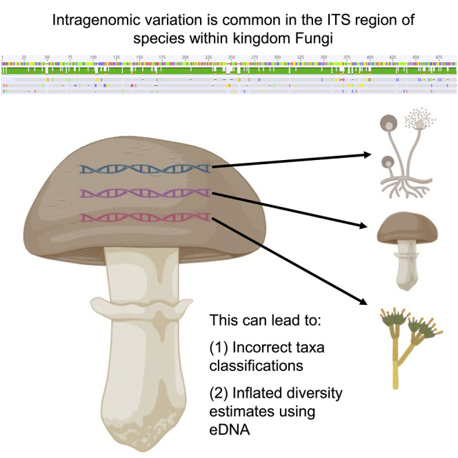
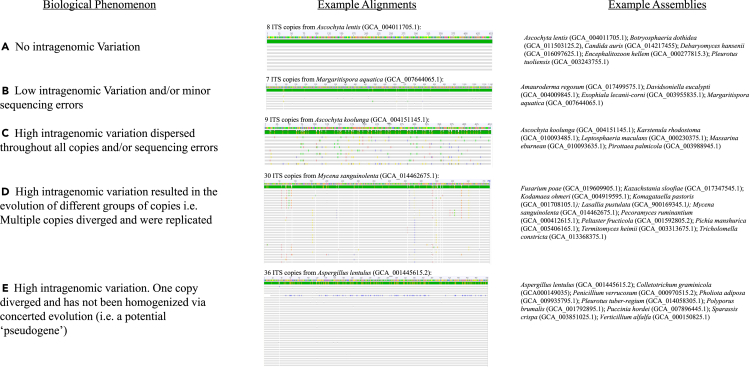

# iScience：2414个真菌基因组揭示ITS条形码的隐藏问题——同一个基因组为何可能被识别为多个物种？

**从rDNA拷贝内差异到基因组污染：一次跨真菌界的调查，重新审视ITS物种鉴定与环境DNA多样性估计的可靠性。**

一个环境样品通过ITS扩增子测序得到了100个ASV，是否意味着样品里存在100种真菌？如果两条ITS序列相差2%或3%，能否直接把它们归为不同物种？一株真菌的基因组中检测到多种彼此差异明显的ITS序列，又该如何解释？

这些问题长期影响真菌分类学、环境DNA（eDNA）和微生物组研究。ITS之所以能成为最常用的真菌DNA条形码，正是因为rDNA通常多拷贝、侧翼区域保守，容易从环境样品中扩增。然而，多拷贝也带来一个容易被忽视的问题：**同一遗传个体内部的ITS拷贝未必完全相同。**

2023年7月10日，Michael J. Bradshaw、M. Catherine Aime、Antonis Rokas等人在 *iScience* 发表论文《Extensive intragenomic variation in the internal transcribed spacer region of fungi》。研究团队从公共数据库中系统整理了 **2,414个真菌物种代表基因组组装**，检索ITS1–5.8S–ITS2区域的不同拷贝，再分析拷贝序列的一致性、测序技术的影响、潜在污染以及对分类和环境多样性估计的后果。

研究发现，**641个组装检测到了两份或更多ITS拷贝，其中419个（约65%）的拷贝并非完全一致**。部分差异达到或超过常见的物种划分阈值。论文由此提出一个重要警告：以ITS序列差异划分的多个分子物种单元，可能来自一个基因组内部；而一些令人意外的ITS序列组合，也可能意味着样本混合或组装污染。

这篇论文并没有否定ITS条形码的价值。它要求我们把ITS看作 **一个通常具有多拷贝、会发生复杂进化并受测序方法影响的基因组区域**，而不是绝对单拷贝、严格遵循物种界限的身份证。

---

## 一、ITS为什么能成为真菌DNA条形码？

真核生物核糖体DNA（rDNA）常以串联重复的方式存在。一个典型的重复单元包含18S（SSU）、ITS1、5.8S、ITS2和28S（LSU）等区段，其中ITS1和ITS2的核苷酸变化一般比编码rRNA的序列更快，适合用于近缘真菌的鉴定。

*图形摘要来自论文原文，用于概括ITS拷贝间差异对物种鉴定和环境测序的影响。*

ITS在真菌研究中有三个实际优势：基因组通常有多个rDNA重复单元，因此低DNA含量样品也较容易扩增；两端保守序列提供了广泛适用的PCR引物结合位点；快速变化的间隔区又提供相对丰富的种间差异。

问题也来自这些优势。多拷贝意味着研究者从一个菌株中扩增到的不是一个绝对唯一的序列，而是同一基因组内一组高度相似、但可能具有不同突变历史的重复序列。PCR扩增效率还可能因引物匹配程度和拷贝比例而改变。

经典模型认为，同一基因组内的rDNA串联重复可以通过不等交换、基因转换等过程发生 **协同进化（concerted evolution）**，使不同拷贝趋于一致。但这种均一化并不总是彻底完成：一些重复单元保留点突变、插入缺失，甚至出现差异非常大的退化序列。

因此，研究问题并非“ITS是否有用”，而是“ITS拷贝在一个基因组内究竟有多一致，这种一致性受到哪些生物学与技术因素影响”。

## 二、2414个真菌基因组：研究是怎样完成的？

作者收集了2021年9月至12月时GenBank中公开的真菌基因组组装，按物种选取一个代表组装。遇到同一个物种有多个版本时，优先检查contig或scaffold数量较少的版本，同时在必要时检查其他组装。

主要步骤是：首先在GenBank中找到相应物种经过注释的ITS参考序列，截取ITS1、5.8S和ITS2区域；随后用BLASTN搜索该物种的基因组组装，收集能匹配到的ITS拷贝；删除明显缺损、比参考ITS短约50 bp以上的片段，再在Geneious中进行多序列比对、统计拷贝数和序列一致性。

数据包含不同测序技术产生的组装，包括Illumina等短读长、PacBio或Oxford Nanopore等长读长，以及混合技术组装。作者还根据ITS与公共序列的比对结果，检查是否存在来自不符物种的可疑序列。

这不是对2414个样本统一重新测序的实验，也不是基于原始reads进行的全体拷贝定量。**研究的直接观察对象是“基因组组装中能够被检索出来的ITS拷贝”**；这种区别直接影响后续数据的解释。

## 三、最重要的数字：641个多拷贝组装，419个存在拷贝间差异

作者在2,414个基因组组装中，找到641个至少包含2份ITS拷贝的组装，约占全部样本的27%。其中：

- 222个组装的已检出ITS拷贝完全一致；
- 303个组装具有相对较低的拷贝内差异，拷贝间一致性为98%–99.99%；
- 116个组装具有较高的差异，拷贝间一致性低于98%；
- 上述116个中的46个组装存在与其他拷贝相似性低于93%的高度分化序列，被作者列为潜在的ITS“假基因”或退化拷贝。

因此，具有任意程度ITS拷贝差异的组装数量是 **303 + 116 = 419**。把419除以所有2,414个组装，得到约17%；但若只在明确检测到至少两份ITS拷贝的641个组装中计算，则为 **419/641 ≈ 65%**。

这两个百分比描述的是不同分母，不能互相替换。尤其重要的是，组装里只发现一份ITS，不等于真实生物学上只有一份ITS。高度重复的rDNA阵列经常在短读长组装中被压缩或塌缩为一份代表序列。

*Fig.1是论文唯一编号的主文研究图，展示了完全一致、少量位点差异、片段差异和高度分化的ITS拷贝等情况。高度分化序列有时会在系统树上形成独立分支，进而影响分子物种界定。*

研究还给出了一个更有价值的质量控制观察：在长读长与短读长结合产生的181个组装中，90个仍然检出ITS拷贝差异，比例为 **49.7%**。这说明拷贝差异不可能全部被简单归因于低质量短读长组装，但也不能据此推出“真菌界恰好有49.7%的物种存在ITS变异”，因为公共基因组具有强烈的取样与技术选择偏倚。

**论文最坚实的结论是：在研究者能够观察到多个ITS拷贝的基因组中，拷贝间不一致非常常见；但对全部真菌物种的总体发生率，还需要更高质量、系统平衡的样本。**

## 四、为什么短读长组装会系统性低估rDNA拷贝数？

rDNA阵列属于高度重复区。许多短读长组装程序很难把连续重复的多个几乎相同的单元完整展开，最终可能把它们“叠放”到一个contig或某个共识序列中。

研究比较不同测序策略时发现，长读长基因组组装中平均检出的ITS拷贝数约为 **14.52**，而短读长组装约为 **1.49**。长、短读长联合产生的组装平均为 **9.43**。这里的均值还受到样本物种构成与数据质量差异的影响，因此不能将两组差异完全解释为测序平台的因果效应。

文章也引用既往基于reads深度的方法，显示真菌rDNA拷贝数可能远超组装能够恢复的水平。按作者讨论，组装中检出多拷贝的样本平均只有10.9份ITS，但另有研究通过深度推断得到过更高的数量级，说明 **“组装里有几份”和“细胞核实际有几份”必须分开报告**。

对于实际的基因组分析，这一点具有直接指导意义。如果某个组装只含有一个ITS序列，而该区域原始reads覆盖度是单拷贝基因的几十倍，则更合理的初步解释通常是rDNA重复被塌缩，而不是该基因组只有一个rDNA单元。

类似地，组装中存在10份ITS，并不一定意味着真实拷贝数为10：部分高度相似拷贝可能被合并，一些低覆盖、易断裂的拷贝可能没有组装出来。

要研究真实的rDNA剂量，可考虑将reads深度、单拷贝基因参照、长读长跨重复单元证据以及不同测序平台的偏倚联合起来。对于异核或二倍体样本，还要明确深度归一化的核型或倍性基线。

## 五、真正危险的是：同一个基因组可能越过“物种划分阈值”

在环境DNA研究中，UNITE的Species Hypotheses等体系通过不同相似性阈值对ITS序列进行聚类。阈值可以帮助建立操作性物种单元，但它们本身不等于物种的生殖隔离或独立演化历史。

作者针对641个包含多个ITS拷贝的组装进行模拟估算，发现如果机械地按不同一致性阈值分群，可能产生如下额外物种单元：

| ITS相似性阈值 | 可能出现额外分群的组装 | 占641个多拷贝组装的比例 |
|---|---:|---:|
| 97% | 93 | 约15% |
| 98% | 116 | 约18% |
| 99% | 171 | 约27% |

这些数字很容易被误读。**93、116和171不是已经被正式错误发表的物种数量，也不是一次真实eDNA样品中实际多出的ASV数量**。它们表示：在作者所观察到的ITS拷贝差异下，如果采用相应聚类阈值，单个基因组内的不同拷贝有可能分配到不同的序列类群。

使用更严格的99%阈值，越容易将较小的基因组内差异拆成多个独立单元。这对于依赖ASV、OTU或Species Hypotheses估计真菌多样性的研究，意味着原始序列单位数可能高于实际生物物种数。

但是，ASV数量也可能受到测序错误、PCR嵌合体、引物偏倚与参考数据库不足影响。**ITS基因组内变异是多样性估计偏差的一个重要来源，但不能据此把所有额外ASV都认定为基因组内变异。**

## 六、从“一个基因组”走向“两个物种”：分类学上的具体案例

作者列举了几组值得重新核查的分类学实例。

最直观的是 *Candida viswanathii*。在对应基因组组装中，研究人员发现5份ITS与该物种已有GenBank序列完全一致，但另外4份与 *Candida pseudoviswanathii* 模式标本的ITS高度相似（约99.7%）。

如果只选取前5份中的某一条，会得到 *C. viswanathii* 的鉴定；如果选取另外4份中的某一条，却可能得到接近 *C. pseudoviswanathii* 的分类结果。

作者由此指出，*C. pseudoviswanathii* 的原始描述主要依据ITS，需要对相关模式材料开展其他分子标记与形态学复核。

**这并不等于论文已经证明二者是同物异名，也不能据此取消一个已发表物种名称。** 要完成正式的分类修订，仍必须比较模式材料、独立遗传标记，并结合相关分类学证据。

其他值得注意的案例包括：*Mucor circinatus* 的不同ITS拷贝分别接近其他 *Mucor* 物种，以及 *Taphrina wiesneri* 某些ITS序列与 *T. confusa* 模式材料更为接近。类似情况可能源自真实基因组内变异，也可能涉及组装混合、误鉴定甚至杂交。

对真菌分类研究而言，这些案例的重点是建立一个复核规则：当单个ITS序列暗示一个非常意外的新物种时，应先确认该序列在宿主基因组中的真实来源，而不应立即以它为唯一依据命名新种。

## 七、哪些ITS序列可能是退化拷贝？引物又会造成怎样的选择偏倚？

在46个组装中，作者检出了与同一组装内其他ITS拷贝相似性低于93%的序列，并把它们列为潜在的退化ITS或“假基因”候选。

这些序列有时包含较多替换、插入和缺失，从而在多序列比对或系统树中形成与主要ITS拷贝远离的分支。

问题在于，**“高度分化”本身尚不足以严格证明某个ITS拷贝已经失去rRNA加工或生物学功能**。要认定退化机制，还需要检查rDNA单元的完整结构、保守位点、转录与加工状态；也要排除组装错误与外源序列。

论文观察到，这类分化较大的ITS序列经常与ITS1、ITS4或ITS5等常用PCR引物存在错配，而且在同一组装中可能只占少数拷贝。常规扩增因此更容易捕获高丰度、引物匹配好的主要类型，使高度分化的拷贝没有进入常见条形码数据库。

这会产生一种研究方法依赖的现象：不同实验使用不同引物，可能观察到不同的ITS拷贝；有些序列在常规扩增中始终不可见，却会在其他引物或非扩增测序中出现。

因此，对于一株真菌是否存在多个ITS类型，简单地“ITS1/ITS4扩增只有一个峰”并不总是充分的排除证据。

## 八、另一个大问题：污染和不同菌株混合，可能伪装成基因组内变异

作者在检查异常ITS拷贝时发现，一些基因组组装实际上包含不属于目标真菌的序列。研究特别关注很难从环境中分离纯培养的专性寄生真菌，包括白粉菌科（Erysiphaceae）与锈菌目（Pucciniales）。

在重点检查的35个相关分类单元中，**12个被标记为存在污染**。作者还报告，在所检查的白粉菌科组装中，至少约82%带有可疑污染信息；锈菌目中相应比例至少约12.5%。这些比例来自研究所选数据，并不代表所有白粉菌或锈菌基因组的污染率。

此外，有些组装中的不同ITS拷贝与同一物种的不同菌株更为接近。例如 *Suillus spraguei* 某个组装中，一部分ITS与一个标本相同，另一部分与另一个菌株相同。

这时可能存在多种解释：测序时混合了不同菌株；同一个基因组确实保留不同rDNA拷贝类型；对于具有两个不同细胞核的真菌，还可能是两个核各自保留不同单倍型。

对于锈菌 *Austropuccinia psidii* 的一个大型组装，作者也提出类似的两种解释：可能涉及多菌株混合，也可能反映两个亲本核的遗传差异。

**这里的关键是，论文通过ITS异常发现了需要核查的基因组组装，并没有通过仅凭ITS的数据证明每一例的真实原因。** 若要进一步区分，可从全基因组覆盖度、GC/k-mer组成、BUSCO多拷贝模式、单拷贝核心基因杂合、等位基因比例、长读长连接证据和样本来源记录入手。

在双核担子菌中，这种区分尤其重要，因为两个核的rDNA差异与一个核内的串联重复差异不是同一个演化层级。

## 九、对已有真菌基因组，怎样开展一套更可靠的rDNA分析？

这部分是基于论文结果整理的实务建议，并非作者已经发布的一条标准化流水线。

首先，为每个基因组选择可靠的rDNA参考序列，识别18S–ITS1–5.8S–ITS2–28S的完整范围。应保存所有非高度截短的匹配结果，并记录方向、长度、匹配覆盖率、拷贝邻近序列与contig位置，避免把极短的保守片段当作独立ITS拷贝。

其次，单独检查重复区组装情况。把原始reads回贴至完整rDNA参考与单拷贝基因组区域，比较局部深度和重复序列的可比对性。对于短读长数据，应评估多重比对reads处理是否影响深度；对长读长数据，可寻找跨重复单元与特异侧翼的reads，检验真实重复单位的数量和排列关系。

第三，分别报告三类差异：同一核内多个rDNA重复单元之间的差异；不同同源染色体或不同核之间的单倍型差异；以及由不同物种或菌株混合产生的外源差异。对没有分相信息的组装，应谨慎使用“核内差异”这个说法，优先报告“组装中检出的ITS序列类型差异”。

第四，对ITS分化类型进行系统发育和完整性复核。构建ITS拷贝树，同时比较同一物种的独立菌株、近缘物种与模式序列；用单拷贝核心基因树作参照，观察异常ITS是否可以由种内变异解释。对高度分化的拷贝，进一步检查是否具有可能影响引物扩增的错配。

第五，把rDNA拷贝数与ITS序列变异分开讨论。前者是重复DNA的剂量问题，需要深度和结构证据；后者是不同拷贝之间的序列差异问题，需要高质量同源比对以及合理的生物学来源判断。

如果这些检查得到一致支持，便可以从单纯的ITS多样性描述，推进到rDNA阵列形成、协同进化、核型分化以及染色体结构演化的机制问题。

## 十、文章真正的研究边界在哪里？

这项研究覆盖了当时公开的2,414个真菌物种代表组装，是一个很有价值的跨真菌界调查；但它依然受到四类限制。

**第一，研究依赖公开组装而非统一测序。** 不同物种的组装技术、质量和深度相差很大，存在很强的采样偏差。不能把样本中观察到的比例无条件推广到全部已描述或尚未描述的真菌物种。

**第二，组装不能可靠估计真实ITS拷贝数。** rDNA阵列尤其容易塌缩。没有原始reads的正交验证，就很难判断组装中检出的多份拷贝占实际基因组的多少。

**第三，很多高度分化的ITS拷贝尚未获得实验验证。** 作者明确表示，本研究是生物信息学调查，没有开展实验室验证。高度分化序列究竟是功能拷贝、退化拷贝、混合菌株，还是组装误差，需要进一步鉴定。

**第四，不同层级的“基因组内变异”可能混在一起。** 尤其对于异核、杂合、杂交或复杂多核体系，组装中检测到多种ITS类型，并不足以确定所有序列位于同一个细胞核的一个rDNA阵列中。

文章数据统计还存在一个值得细心核对的小问题：正文在描述全部2,414份组装时，分别给出未找到ITS的695份、仅检出一份的1,080份和多份的641份，这三个报告数相加为2,416，较总样本数多2。**这并不影响文中641份多拷贝组装与419份存在差异的主要结果，但提醒读者引用基础分类统计时应以补充数据为准。**

从现有证据看，论文最明确地证实了组装可观察层面的ITS异质性及其潜在分类后果；它尚未直接测定真菌界真实的rDNA拷贝数分布，也不能精确计算现有真菌物种中有多少正式名称应被撤销。

## 结语：ITS依然是重要工具，但不应独自承担全部物种鉴定

这项研究表明，ITS多拷贝带来的问题在真菌界并不罕见。多拷贝组装中约65%存在不同程度的序列差异，部分高度分化的拷贝甚至能够跨越常见的操作性物种相似性阈值。与此同时，rDNA重复区的组装塌缩、引物选择、基因组污染和不同核的遗传组成，都可能影响研究者最终看到的ITS序列。

其实际意义不仅在于“ITS可能高估物种多样性”，更在于重新建立ITS证据的层级：一个序列类型是一个分子观测，一个基因组可能含多个类型，而一个物种的认定需要来自基因组、形态、生态或独立分子标记的进一步支持。

对于真菌生态学、群体基因组和物种分类，可靠的研究策略不是放弃使用三十多年的ITS数据，而是将其放回整个基因组和生物学背景中解释。

---

**原始论文**

Bradshaw MJ, Aime MC, Rokas A, et al. (2023). *Extensive intragenomic variation in the internal transcribed spacer region of fungi*. **iScience** 26(8):107317. Online published 10 July 2023.

DOI：https://doi.org/10.1016/j.isci.2023.107317

Cell Press原文：https://www.cell.com/iscience/fulltext/S2589-0042(23)01394-9

PMC开放获取全文：https://pmc.ncbi.nlm.nih.gov/articles/PMC10387565/

原始比对数据与补充表：https://doi.org/10.5061/dryad.g79cnp5t7

**图片版权与使用说明：** 原论文在PMC标注为CC BY 4.0。本文仅引用原文图形摘要和唯一编号主文图Fig.1，保留原始图的全部内容和出处，不做裁剪或加字；转载时仍需核对图片中的独立第三方权利说明。